# A.R.M.S. — Anti-drone Reusable Modular System

**비전 기반 모듈형 재사용 요격드론 시스템** · 2026 한이음 드림업 · Team INAIR


---

## 💡 1. 프로젝트 개요

### 1-1. 프로젝트 소개
- **프로젝트 명** : A.R.M.S. (Anti-drone Reusable Modular System) — 모듈형 재사용 요격드론 시스템
- **프로젝트 정의** : 카메라 영상만으로 침입 드론을 탐지·추적해 충돌 요격하는 모듈형 재사용 요격드론 시스템입니다. 고가 연산 장치는 지상 발사기에 두고 기체는 저가로 유지하며, 임무 실패·취소 시 수동 조종이나 GPS 자동 복귀로 기체를 회수해 다시 사용합니다.

### 1-2. 개발 배경 및 필요성
- 소형 드론은 전장 사상자의 70~80%를 차지할 만큼 주력 위협이 되었지만, 레이더에 잘 잡히지 않고 수억 원대 미사일로 수십만 원짜리 드론을 상대하는 것은 경제적으로 지는 싸움입니다.
- 전파 교란은 도심·기지에서 사용이 제한되고, 요격체는 손실 가능성이 높아 대당 단가가 곧 운용 비용이 됩니다.
- 따라서 **저비용으로 반복 운용할 수 있는 휴대형 물리 요격 수단**이 필요합니다.

### 1-3. 프로젝트 특장점
- **비전 기반** : 레이더 없이 FPV 카메라 한 대로 탐지 → 락온 → 추적 · 유도까지 처리 (HSV + YOLOv11 2단 검출, 프레임당 17 ms)
- **모듈형** : 나사산 체결식 전방 하우징만 교체하면 요격 · 전차 대응 · 대인 등 임무 전환
- **재사용** : 자동 ↔ 수동 즉시 전환, 통신 두절 시 GPS 자동 복귀(RTL)로 기체 회수
- **분산 구조** : 고가의 Jetson Orin Nano는 지상 발사기에, 기체에는 카메라 · FC · 추진계만 탑재해 기체 단가를 낮춤
- **자체 기술** : STM32F407 기반 비행 제어기를 회로부터 펌웨어까지 직접 개발
- **데이터 기반 개발** : 모든 비행을 자동 기록하고 웹에서 재생 · 분석하는 비행 로그 분석 시스템 구축

### 1-4. 주요 기능
| 기능 | 설명 |
|---|---|
| HSV + YOLO 2단 표적 검출 | HSV로 붉은 후보 영역을 추출하고 해당 영역만 YOLOv11(TensorRT FP16)로 검증, 칼만 필터로 평활 |
| 임무 상태머신 | IDLE → SEARCH → LOCK → TRACK → RTL 5단계 자동 관리 |
| 영상 기반 유도 제어 | 영상 오차를 Roll · Pitch 각속도 명령으로 변환 (PID · 비례항법 · 배리어 함수 IBVS, 파라미터로 전환) |
| 근접 판정 | 표적 팽창률(looming)로 충돌 예상 시간(τ)을 추정해 근접 시 이득 · 추력 완화 |
| 자동 / 수동 이중 조종 | 영상 유도 ↔ 손조종 즉시 전환, 표적 소실 2초 시 수동 조종으로 자동 인계 |
| GPS 자동 복귀 | 조종기 RTL 버튼 · 조종 입력 두절(0.3초) · 통신 두절(2초) 시 GPS Rescue로 이륙 지점 귀환 |
| 다중 안전 인터록 | 스틱 idle 확인, ARM 재토글 요구, 발사 클램프 상태 전이 엣지 제어 |
| 비행 로그 분석 | ARM과 동시에 rosbag2 자동 녹화, 웹에서 그래프 28종 · 영상 · 3D 궤적 동기 재생 |
| SITL 시뮬레이션 | Gazebo Harmonic + PX4 SITL에서 실기체와 같은 코드로 폐루프 검증 |

### 1-5. 기대 효과 및 활용 분야
- **기대 효과** : 미사일 대비 수백 분의 1 비용으로 반복 운용 가능한 휴대형 요격 수단, 기체 회수 · 재사용으로 운용 단가 절감
- **활용 분야** : 군 기지 · 국가중요시설 방호, 교정시설 · 공항 · 발전소 드론 침입 대응, 대규모 행사 보안, 자율비행 · 컴퓨터비전 교육 플랫폼

### 1-6. 기술 스택
| 구분 | 기술 |
|---|---|
| 지상 연산 | Jetson Orin Nano, Ubuntu 22.04, ROS 2 Humble, Docker |
| 영상 인식 | YOLOv11, TensorRT (FP16), OpenCV, Roboflow |
| 제어 · 통신 | C++ / Python ROS 2 노드, CRSF · ELRS 2.4 GHz, 5.8 GHz 아날로그 영상 |
| 비행 제어기 | STM32F407 + ICM42688P (자체 개발 FC, STM32CubeIDE) |
| 시뮬레이션 | Gazebo Harmonic, PX4 SITL, ros_gz_bridge |
| 로그 분석 | rosbag2 (SQLite), Flask, uPlot, three.js, ffmpeg, Docker |
| 기구 설계 | Fusion 360, FDM 3D 프린팅 (STEP 파일: [`HW/drone_step`](HW/drone_step), [`HW/launcher_step`](HW/launcher_step)) |

### 1-7. 요격 기체 사양
| 항목 | 사양 | 항목 | 사양 |
|---|---|---|---|
| 형태 | 수직 적층형 쿼드콥터 | 영상 | 전방 · 측방 FPV 카메라, 5.8 GHz VTX |
| 중량 | 950 g | 제어 링크 | ELRS 2.4 GHz · CRSF 50 Hz |
| 최고 속도 | 200 km/h | 위치 | GPS (위치 · 고도 · 속도, 자동 복귀) |
| 추진 | Velox V2 1750KV 모터 × 4 | 전방 모듈 | 교체형 하우징 (요격 · 전차 · 대인) |
| 비행 제어기 | 자작 STM32F407 FC | 교전 · 추적 | 최대 200 m · 최대 3분 |
| 전원 | 6S 1800 mAh 140C LiPo, 외부 전원 키(XT60) | | |

---

## 💡 2. 시스템 구성도

### 2-1. 전체 시스템 및 신호 흐름
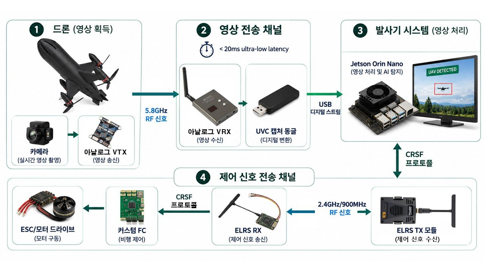

- **제어 신호 (발사기 → 기체)** : 조종 입력 / 자동 유도 명령 → Jetson → CRSF 변환 → Ranger Micro TX → ELRS 무선 → 기체 수신기 → 자작 FC → ESC → 모터
- **영상 신호 (기체 → 발사기)** : FPV 카메라 → 5.8 GHz VTX → RC832 수신기 → USB 캡처 → Jetson (검출 · 유도) → 발사기 화면

### 2-2. H/W 구성
| 요격 기체 외형 (전면 · 후면) | 기체 전장 적층 구조 |
|:---:|:---:|
| 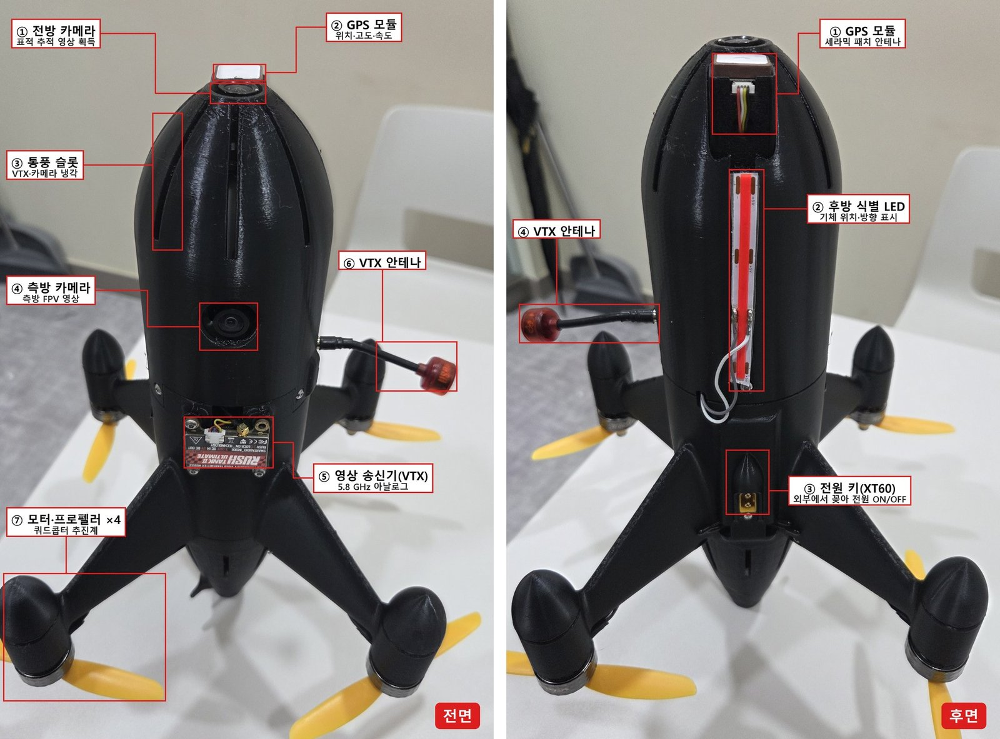 | 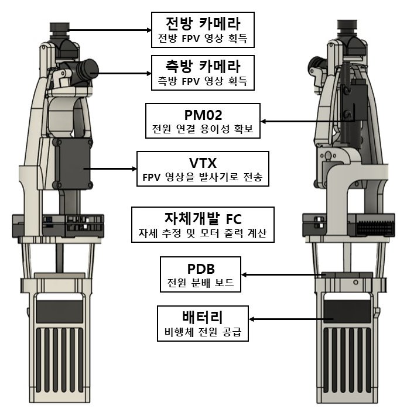 |

| 견착형 발사기 전장 | 교체형 전방 모듈 (요격 · 전차 · 대인) |
|:---:|:---:|
| 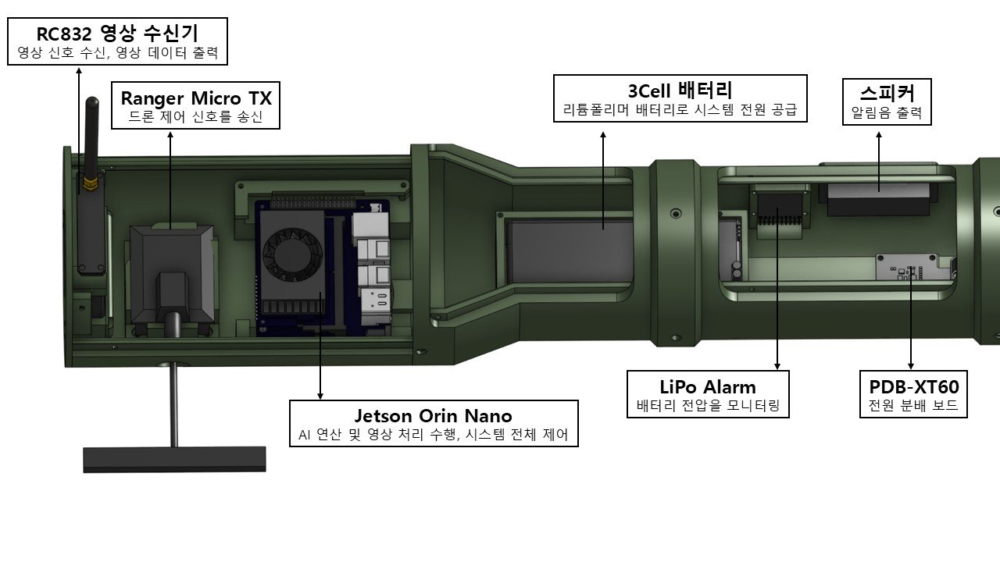 | 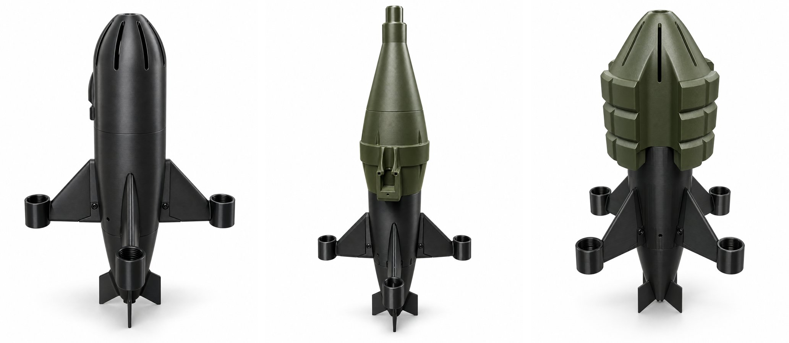 |

### 2-3. S/W 구성
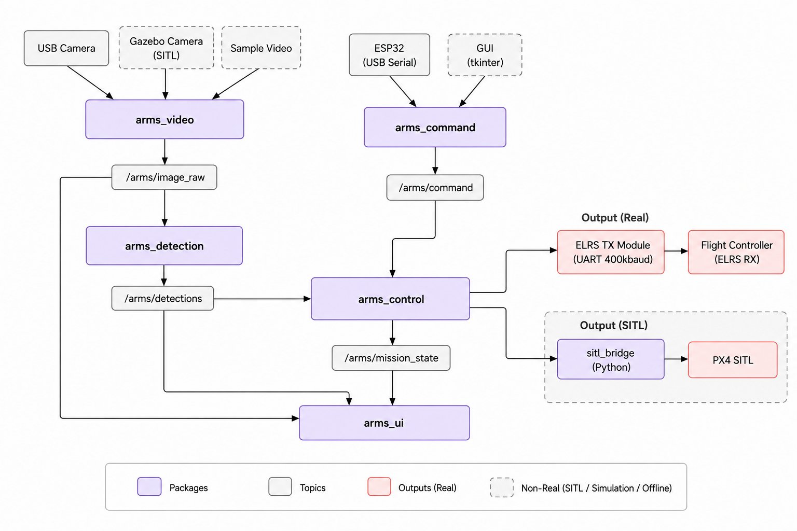

| 패키지 | 역할 |
|---|---|
| `arms_video` | 영상 소스 추상화 (USB 캡처 / 시뮬레이터) |
| `arms_detection` | HSV + YOLOv11 표적 검출 · 칼만 필터 추적 (Docker, TensorRT) |
| `arms_operator` | 조종기(ESP32) · 가상 조종기 입력 |
| `arms_control` | 임무 상태머신 · 유도 제어 · 안전 인터록 |
| `arms_flight_io` | CRSF 송수신 · GPS · 배터리 · 자세 텔레메트리 |
| `arms_ui` | 운용 화면 오버레이 (상태 · 표적 · GPS · 경고) |
| `arms_logging` | 비행 로그 자동 기록 (rosbag2) |
| `arms_sim` | Gazebo + PX4 SITL 환경 |
| `arms_msgs` | 시스템 전용 메시지 |

### 2-4. 임무 상태머신
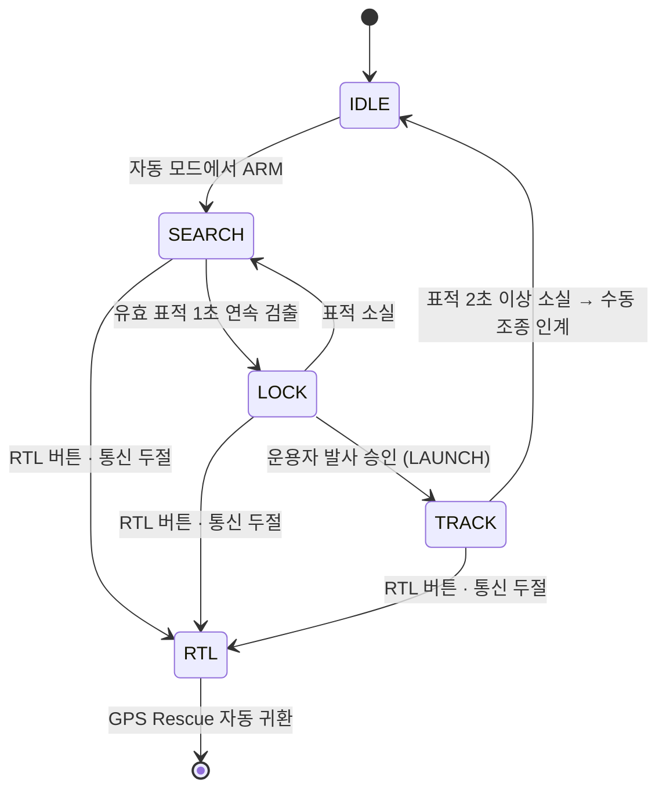

### 2-5. 비행 로그 자동 기록 · 분석 시스템
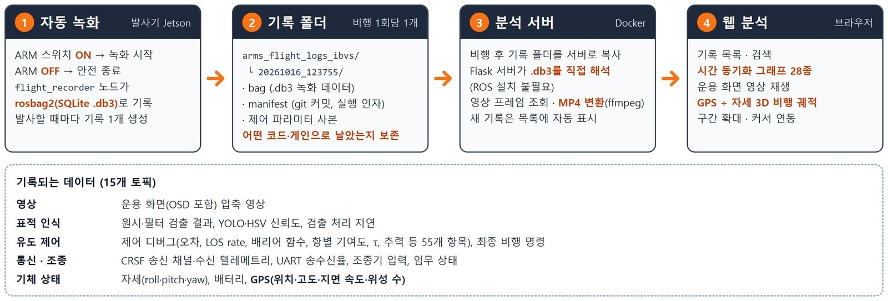
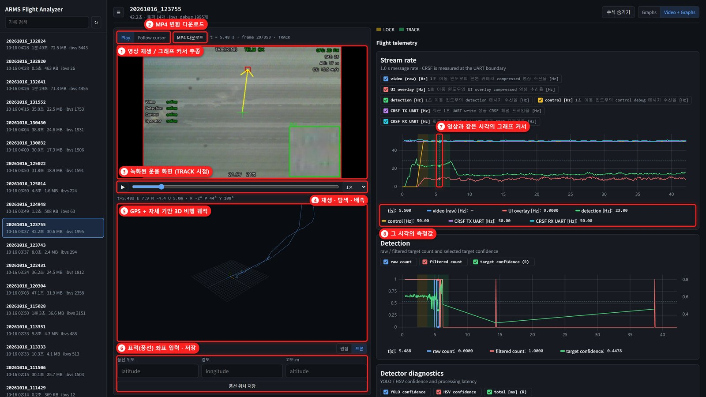

### 2-6. 검증 과정 (SITL → 테스트 리그 → 실기체)
| Gazebo + PX4 SITL 폐루프 검증 | 테스트 리그 이득 튜닝 |
|:---:|:---:|
| 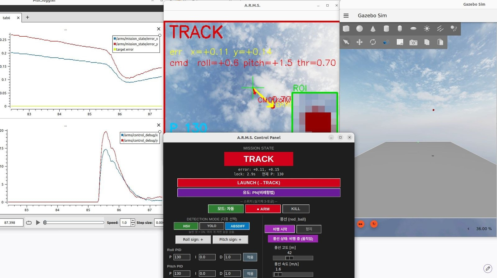 | 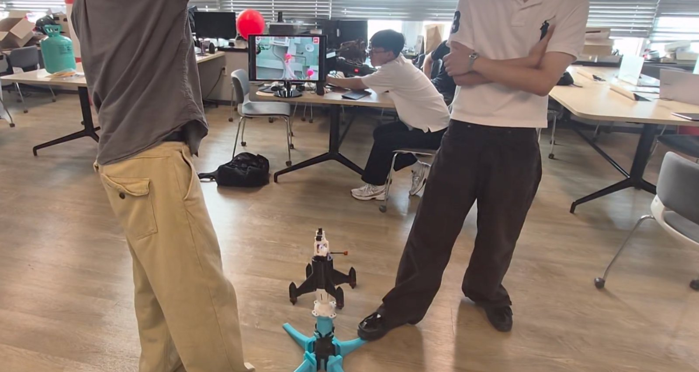 |

| 공중 표적(풍선) 추적 | 실기체 GPS 자동 복귀(RTL) 검증 |
|:---:|:---:|
| 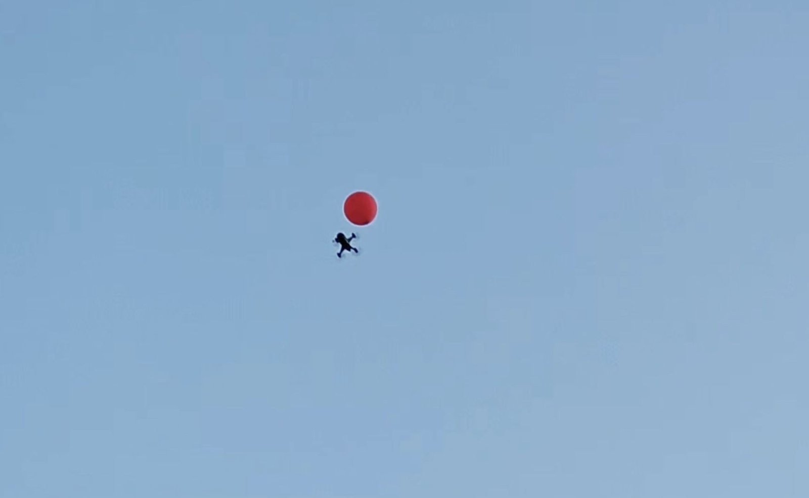 | 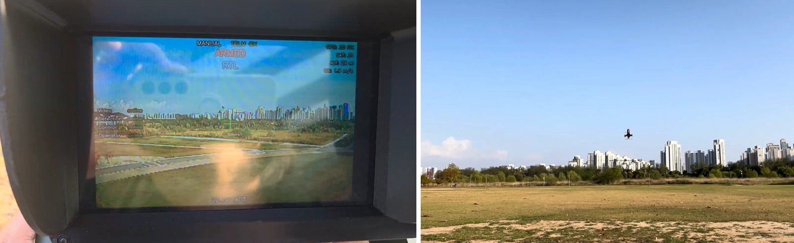 |

---

## 💡 3. 작품 소개영상

[](https://www.youtube.com/watch?v=Cgwz7hQSDEw)

> 썸네일을 클릭하면 유튜브에서 작품 소개영상이 재생됩니다.

---

## 💡 4. 핵심 소스코드

### 4-1. 영상 기반 유도 제어 — PID + 시간 기반 리드
[`SW/arms_ws/src/arms_control/src/arms_control_node.cpp`](SW/arms_ws/src/arms_control/src/arms_control_node.cpp)

화면 중심 대비 표적 오차(카메라 tan 좌표)에 표적 각속도만큼 앞선 리드를 더해, 기체의 Roll · Pitch **각속도 명령**으로 변환합니다. 이 명령은 CRSF로 전송되어 자작 FC의 내부 Rate 루프(ACRO)가 안정화합니다.

```cpp
// ===== 기본 추적: PID + 시간기반 리드 =====
double t_lead = lead_gain_;
double ex_lead = ex + t_lead * err_dot_x_;   // 표적 각속도만큼 앞서 겨냥
double ey_lead = ey + t_lead * err_dot_y_;
roll_rate_cmd = roll_sign_ * gain_scale * pid_roll_->compute(ex_lead, dt);
double pitch_scale = 1.0;
if (gain_shaping_) {          // roll 오차가 크면 pitch 를 눌러 좌우 정렬 우선
  if (fabs(ex) > 0.12)      pitch_scale = 0.8;
  else if (fabs(ex) > 0.06) pitch_scale = 0.9;
}
pitch_rate_cmd = pitch_sign_ * gain_scale * pitch_scale * pid_pitch_->compute(ey_lead, dt);
```

유도 모드는 파라미터 `control.guidance_mode` 하나로 전환합니다 (0 = PID, 1 = 비례항법, 2 = 배리어 함수 IBVS). 아래는 IBVS 모드의 핵심입니다.

```cpp
// ===== IBVS 공선유도 (배리어 Lyapunov) =====
const double Nn  = std::sqrt(1.0 + x_n * x_n + y_n * y_n);
double z1 = 1.0 - 1.0 / Nn;                         // 공선 오차 = 1 - cos(theta)
const double z1_max = ibvs_kb_ * 0.995;             // 배리어 안쪽으로 강제
if (z1 > z1_max) z1 = z1_max;
const double denom   = std::max(ibvs_kb_ * ibvs_kb_ - z1 * z1, 1e-6);
const double barrier = z1 / denom;                  // 중앙에선 ~0, 시야 가장자리에서 발산
const double dir_x = x_n / Nn, dir_y = y_n / Nn;   // 회전축 방향
// 배리어항(시야 유지) + 선형항(중앙 권한) + LOS 각속도항(리드/감쇠)
const double rc = (ibvs_gain_ * barrier + ibvs_center_gain_) * dir_x + ibvs_los_rate_gain_ * ldx;
const double pc = (ibvs_gain_ * barrier + ibvs_center_gain_) * dir_y + ibvs_los_rate_gain_ * ldy;
```

### 4-2. 임무 상태머신 — 락온 · 발사 승인 · 수동 인계
[`SW/arms_ws/src/arms_control/src/state_machine.cpp`](SW/arms_ws/src/arms_control/src/state_machine.cpp)

```cpp
if (state_ == State::SEARCH) {
  if (!lock_timer_running_) { lock_start_time_ = now; lock_timer_running_ = true; }
  lock_elapsed_sec_ = std::chrono::duration<double>(now - lock_start_time_).count();
  if (lock_elapsed_sec_ >= params_.lock_duration_sec) {   // 유효 표적이 일정 시간 연속 유지
    transition(State::LOCK);
    target_locked_ = true;
  }
}

void StateMachine::on_launch_button() {
  if (state_ == State::LOCK) transition(State::TRACK);     // 운용자 발사 승인 시에만 추적 시작
}

void StateMachine::on_detection_timeout() {
  if (state_ == State::TRACK) {
    // 추적 중 표적을 놓치면 유도를 멈추고 조종사에게 즉시 인계
    manual_handover_requested_ = true;
    transition(State::IDLE);
    return;
  }
  ...
}

void StateMachine::request_rtl() {
  if (state_ != State::RTL) transition(State::RTL);       // RTL 버튼 · 통신 두절 → GPS 자동 복귀
}
```

### 4-3. 비행 로그 자동 기록 — ARM 연동
[`SW/arms_ws/src/arms_logging/arms_logging/flight_recorder.py`](SW/arms_ws/src/arms_logging/arms_logging/flight_recorder.py)

```python
def _cb_cmd(self, msg: OperatorInput):
    arm = int(msg.arm_switch)
    if arm and not self._arm and not self._recording():
        self._start()                      # ARM 올림 → 녹화 시작 (코드 버전 · 제어 파라미터 함께 저장)
    elif not arm and self._recording():
        self._stop("ARM 스위치 OFF")        # ARM 내림 → 녹화 종료·저장
    self._arm = arm
```

---

## 📁 저장소 구조

```
ARMS/
├── SW/                     # 소프트웨어 (ROS 2 워크스페이스, 로그 분석기, 스크립트) → SW/README.md
│   ├── arms_ws/src/        #   ROS 2 패키지
│   ├── scripts/            #   flight_analyzer(로그 분석기), YOLO 학습 등 도구
│   └── docs/               #   설계 · 설치 문서
├── HW/                     # 하드웨어
│   ├── drone_step/         #   요격 기체 CAD (STEP)
│   ├── launcher_step/      #   견착형 발사기 CAD (STEP)
│   ├── drone/              #   Gazebo 시뮬레이션용 URDF/SDF
│   └── ElectricalSystemDesign.md
└── images/                 # README 이미지 · 영상
```

설치 및 실행 방법은 [SW/README.md](SW/README.md)와 [SW/docs/SETUP.md](SW/docs/SETUP.md)를 참고하세요.
