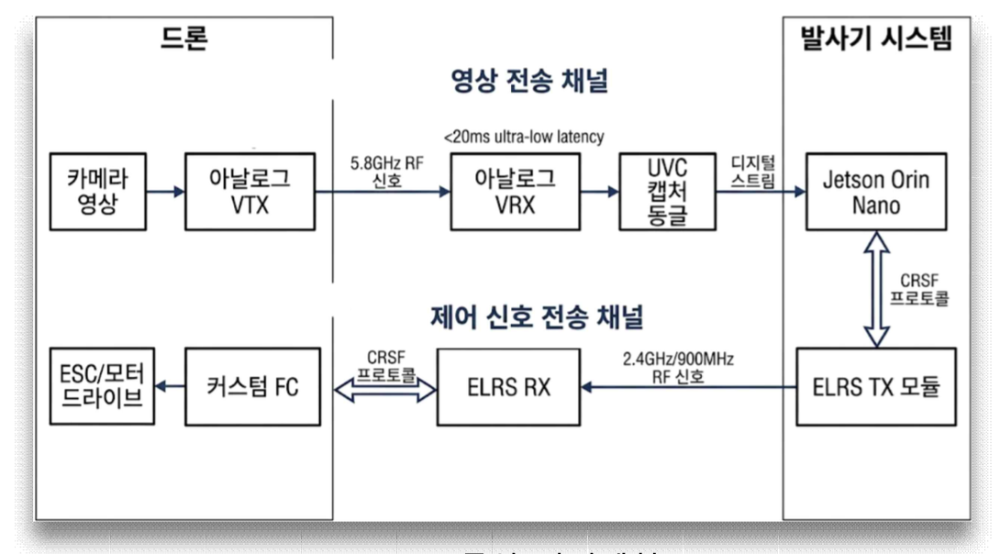
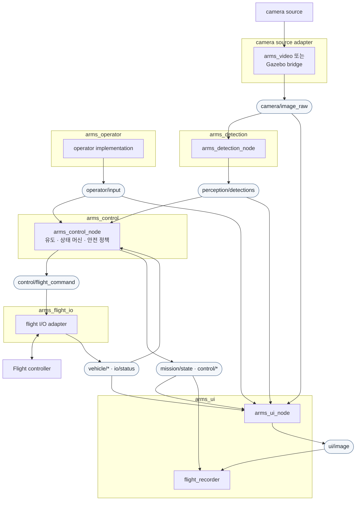
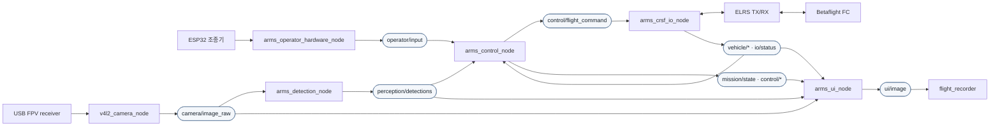
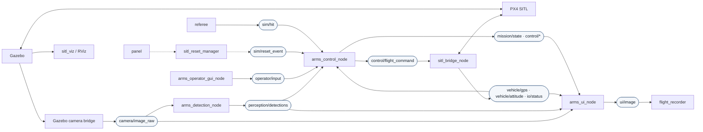
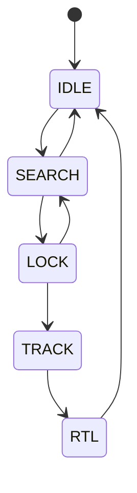
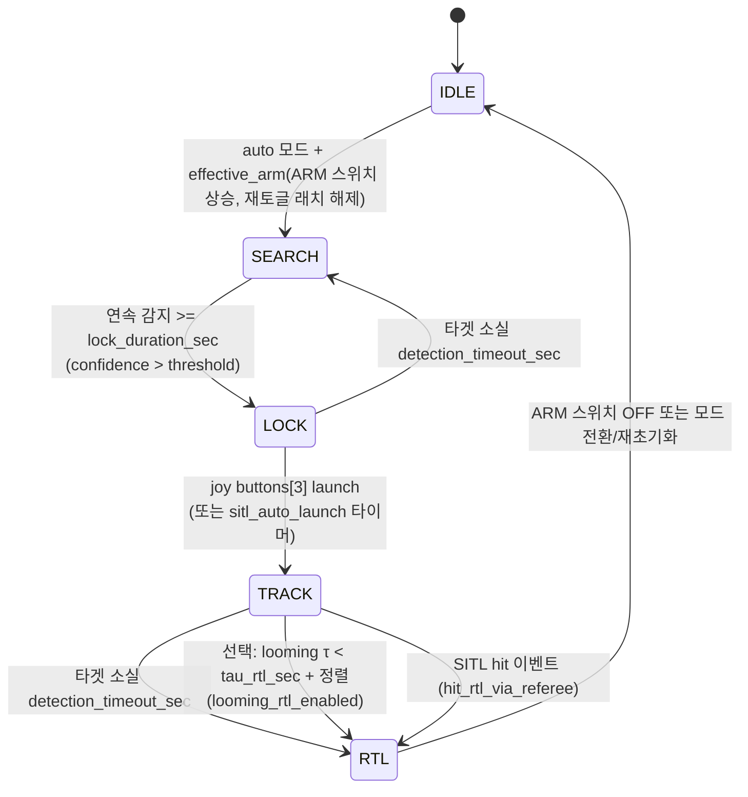
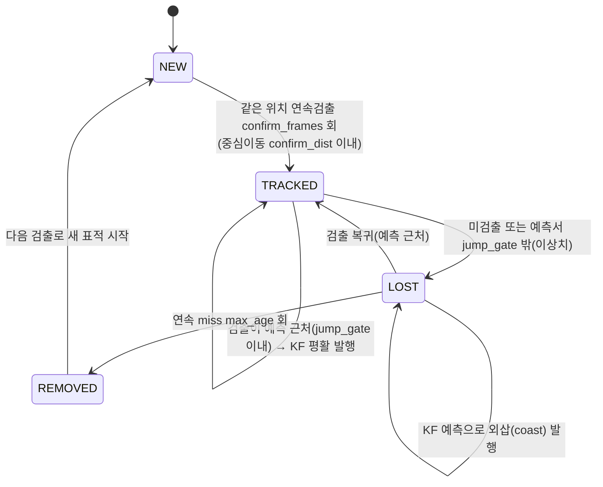

# A.R.M.S. 소프트웨어 설계 문서

_Anti-drone Reusable Modular System — Software Architecture_

## 0. I/O 경계와 namespace 계약

### 0.1 Namespace

새 인터페이스의 토픽은 노드 소스에서 모두 상대 이름으로 쓴다. 최상위 launch가
`namespace` argument(기본 `arms`)를 적용하므로 기본 실행의 `vehicle/gps`는
`/arms/vehicle/gps`로 해석된다. 다기체 실행은 같은 노드·토픽 계약에
`namespace:=arms/uav_01`만 적용한다.

### 0.2 제어와 FC 통신 분리

```text
operator/input + perception/* + vehicle/* + io/status
  → arms_control_node
  → control/flight_command (FlightCommand)
  → arms_flight_io
      ├─ arms_crsf_io_node : 실기체 CRSF/ELRS, Betaflight AUX 매핑
      └─ sitl_bridge_node  : SITL MAVLink, PX4 arm/mode/RTL 매핑
```

`arms_control_node`는 UART, CRSF, MAVLink, Gazebo, RC 채널 번호를 직접 알지 않는다.
`FlightCommand`는 정규화된 roll/pitch/yaw/throttle과 arm/manual/RTL 의도만 담고,
실제 RC/AUX 변환은 `arms_flight_io`가 맡는다.

| 도메인     | 공개 토픽                                                                                       |
| ---------- | ----------------------------------------------------------------------------------------------- |
| operator   | `operator/input`                                                                                |
| control    | `control/flight_command`, `control/debug`, `control/ibvs_debug`, `control/looming_debug`        |
| vehicle    | `vehicle/gps`, `vehicle/attitude`, `vehicle/battery`                                            |
| I/O        | `io/status`, `io/crsf/rx`, `io/crsf/tx`                                                         |
| perception | `perception/detections`, `perception/detections_raw`, `perception/status`, `perception/*_debug` |
| mission    | `mission/state`                                                                                 |
| SITL only  | `sim/hit`, `sim/reset` 서비스, `sim/reset_event`, `sim/viz/*`                                   |

`io/status`는 CRSF/FC 또는 PX4 telemetry의 관측 상태만 보고한다. ESP32 입력 timeout,
타겟 소실, RTL 판단은 `arms_control_node`가 담당한다. GPS Rescue 불가 시 fallback은
Betaflight FC 설정에 맡긴다.

### 0.3 로그 시간축과 reset

ARMS Flight Analyzer의 재생·영상·3D·그래프 동기화 기준은 rosbag 저장 timestamp다.
header stamp는 측정·수신 시각 및 지연 분석용 보조 정보이며, 현재는 `/clock`이나
`use_sim_time`을 사용하지 않는다. manifest에는 `topic_schema_version`, namespace,
`use_sim_time`을 남긴다.

SITL reset panel은 `sim/reset` 서비스를 호출한다. `sim_reset_manager`가 Gazebo를 유지한
채 PX4 재기동을 확인한 뒤 `sim/reset_event`를 한 번 발행하여 control/referee/UI의 상태를
초기화한다. 실기체에는 이 서비스와 이벤트를 launch하지 않는다.

구형 `/arms/...` 토픽 형식의 bag은 새 Flight Analyzer에서 지원하지 않는다.

## 목차

0. [I/O 경계와 namespace 계약](#0-io-경계와-namespace-계약)
1. [시스템 개요](#1-시스템-개요)
2. [ROS 패키지 구조](#2-ros-패키지-구조)
3. [노드 및 토픽 구조](#3-노드-및-토픽-구조)
4. [상태 머신](#4-상태-머신-arms_control-내부)
5. [영상 수신 (arms_video)](#5-영상-수신-arms_video)
6. [객체 인식 (arms_detection)](#6-객체-인식-arms_detection)
7. [비행 제어 및 통신 (arms_control)](#7-비행-제어-및-통신-arms_control)
8. [운용자 입력 (arms_operator)](#8-운용자-입력-arms_operator)
9. [오퍼레이터 UI (arms_ui)](#9-오퍼레이터-ui-arms_ui)
10. [런치 파일 구조](#10-런치-파일-구조)
11. [전체 데이터 흐름 요약](#11-전체-데이터-흐름-요약)

## 1. 시스템 개요

### 1.1 물리 구성



### 1.2 소프트웨어 레이어

```
+----------------------------------------------------------+
|                    Operator Interface                    |
|                    (Monitor Display)                     |
+----------------------------------------------------------+
|   Video Pipeline   |  Detection  |      Control         |
|  (V4L2 -> ROS)     |  (YOLO)     |  PID + State Machine |
|                    |             |  CRSF serial output  |
+----------------------------------------------------------+
|              ROS 2 Middleware (Humble)                   |
+----------------------------------------------------------+
|         Jetson Hardware (CUDA, V4L2, UART/ELRS)          |
+----------------------------------------------------------+
```

## 2. ROS 패키지 구조

```
arms_ws/
└── src/
    ├── arms_bringup/          # 최상위 런치 파일 및 설정
    ├── arms_video/            # 영상 소스 추상화 (v4l2_camera / gz_ros2_bridge)
    ├── arms_detection/        # 검출 노드 (HSV 후보 → ROI YOLO 검증 + KF 필터, Docker)
    ├── arms_operator/         # 운용자 입력 → operator/input (SITL 가상 조종기 / 실기체 ESP32)
    ├── arms_flight_io/        # FlightCommand ↔ FC I/O (CRSF 또는 MAVLink)
    ├── arms_sim/              # SITL 전용: 표적 심판(referee) + 튜닝/심판 콘솔(panel)
    ├── arms_control/          # 상태 머신 + PID → control/flight_command
    ├── arms_ui/               # 오퍼레이터 디스플레이 (OpenCV 오버레이)
    └── arms_msgs/             # 커스텀 메시지 정의
```

## 3. 노드 및 토픽 구조

### 3.1 공통 논리 구조



### 3.2 실행 환경별 배포 구조

#### 3.2.1 실기체



#### 3.2.2 SITL



### 3.3 노드 및 토픽 요약

| 노드                                         | subscribe / service                                                                                                                                    | publish                                                                                       | 실행 환경     |
| -------------------------------------------- | ------------------------------------------------------------------------------------------------------------------------------------------------------ | --------------------------------------------------------------------------------------------- | ------------- |
| `v4l2_camera_node` 또는 Gazebo camera bridge | 카메라 장치 또는 Gazebo                                                                                                                                | `camera/image_raw`, `camera/camera_info`                                                      | 실기체 / SITL |
| `arms_detection_node`                        | `camera/image_raw`                                                                                                                                     | `perception/detections`, `perception/detections_raw`, `perception/status`, 디버그 영상        | 실기체 / SITL |
| `arms_operator_hardware_node`                | ESP32 USB Serial                                                                                                                                       | `operator/input`                                                                              | 실기체        |
| `arms_operator_gui_node`                     | tkinter 사용자 입력                                                                                                                                    | `operator/input`                                                                              | SITL          |
| `arms_control_node`                          | `operator/input`, `perception/detections`, `vehicle/*`, `io/status`, `sim/hit`, `sim/reset_event`                                                      | `control/flight_command`, `mission/state`, `control/*_debug`                                  | 실기체 / SITL |
| `arms_crsf_io_node`                          | `control/flight_command`, CRSF/ELRS UART                                                                                                               | `io/crsf/rx`, `io/crsf/tx`, `vehicle/gps`, `vehicle/attitude`, `vehicle/battery`, `io/status` | 실기체        |
| `sitl_bridge_node`                           | `control/flight_command`, PX4 MAVLink                                                                                                                  | `vehicle/gps`, `vehicle/attitude`, `io/status`; MAVLink RC/AUX·arm·RTL 명령                   | SITL          |
| `arms_ui_node`                               | `camera/image_raw`, `perception/detections`, `mission/state`, `control/debug`, `operator/input`, `vehicle/gps`, `vehicle/battery`, `perception/status` | `ui/image`                                                                                    | 실기체 / SITL |
| `flight_recorder`                            | 기록 대상 토픽과 `operator/input`                                                                                                                      | rosbag, manifest                                                                              | 실기체 / SITL |
| `panel`                                      | `mission/state`; `sim/reset` client                                                                                                                    | 제어·심판 파라미터 변경 요청                                                                  | SITL          |
| `referee`                                    | `sim/reset_event`                                                                                                                                      | `sim/hit`                                                                                     | SITL          |
| `sitl_reset_manager`                         | `sim/reset` service                                                                                                                                    | `sim/reset_event`                                                                             | SITL          |
| `sitl_viz`                                   | `sim/reset_event`, Gazebo truth                                                                                                                        | `sim/viz/*`                                                                                   | SITL          |

### 3.4 노드별 역할

| 노드                                                 | 패키지                       | 책임                                                                                                     |
| ---------------------------------------------------- | ---------------------------- | -------------------------------------------------------------------------------------------------------- |
| 카메라 source                                        | `arms_video` / Gazebo bridge | 카메라 프레임을 `camera/*` 계약으로 제공한다.                                                            |
| `arms_detection_node`                                | `arms_detection`             | 영상으로부터 검출·상태·진단을 `perception/*`으로 제공한다.                                               |
| `arms_operator_hardware_node`                        | `arms_operator`              | ESP32 패킷을 파싱·스케일 변환해 `OperatorInput`으로 전달한다. timeout·RTL·arm 정책은 수행하지 않는다.    |
| `arms_operator_gui_node`                             | `arms_operator`              | SITL GUI 상태를 동일한 `OperatorInput`으로 발행한다.                                                     |
| `arms_control_node`                                  | `arms_control`               | 유도, 상태 머신, 입력 timeout, arm/RTL 안전 정책을 결정하고 hardware-independent `FlightCommand`를 낸다. |
| `arms_crsf_io_node`                                  | `arms_flight_io`             | 실기체에서 FlightCommand를 CRSF/AUX로 변환하고 CRSF telemetry를 `vehicle/*`로 정규화한다.                |
| `sitl_bridge_node`                                   | `arms_flight_io`             | SITL에서 FlightCommand를 PX4 MAVLink 명령으로 변환하고 PX4 telemetry를 `vehicle/*`로 정규화한다.         |
| `arms_ui_node`                                       | `arms_ui`                    | 영상·비행 상태·입력 상태를 오버레이한 `ui/image`를 생성한다.                                             |
| `flight_recorder`                                    | `arms_ui`                    | 비행 단위 rosbag과 manifest를 저장한다.                                                                  |
| `panel`, `referee`, `sitl_reset_manager`, `sitl_viz` | `arms_sim`                   | Gazebo 표적·reset·튜닝과 RViz 시각화를 제공한다. control 또는 FlightCommand를 우회하지 않는다.           |

## 4. 상태 머신 (arms_control 내부)

### 4.1 상태별 동작 정의

| 상태       | 드론 동작                       | CRSF 출력                                                | 서보 잠금장치              | UI 표시                   |
| ---------- | ------------------------------- | -------------------------------------------------------- | -------------------------- | ------------------------- |
| **IDLE**   | 정지 대기                       | CH3=min, CH1/2=center, CH5=disarm                        | **OPEN**(진입 시)          | 회색 테두리               |
| **SEARCH** | 타겟 탐색 중                    | CH3=min, CH5=`auto_arm_states` 설정에 따름               | **LOCK**(IDLE→SEARCH 엣지) | 노란색, "Searching..."    |
| **LOCK**   | 타겟 포착 확인 중 (잠금 타이머) | CH5=`auto_arm_states` 설정에 따름 (클램프는 잠김)        | LOCK 유지                  | 주황색 박스, "Locking..." |
| **TRACK**  | 위치 보정 추적                  | **CH5=arm** + PID → CH1/2 + track_throttle → CH3         | **OPEN**(LOCK→TRACK 엣지)  | 빨간 박스, "LOCKED"       |
| **RTL**    | GPS Rescue 귀환 및 착륙 요청    | CH5=arm 유지(ARM 스위치가 올라간 경우), **CH7=RTL high** | OPEN 유지                  | "RTL"                     |

> **자동 모드 arm(CH5)은 상태머신 상태로 결정**(스위치와 분리). 기본은 `SEARCH`부터 상태를 진행하되
> CH5 무장은 `control.auto_arm_states` 설정으로 정한다(현재 기본값 `[SEARCH, LOCK, TRACK, RTL]`).
> LOCK에서는 클램프가 기체를 고정하고, TRACK 전이에서 서보가 열린다. 수동 모드 CH5 는 arm 스위치.

> **서보 잠금장치(발사 클램프)**: 발사 전 기체를 발사기에 고정하고 발사 순간에만 놓아준다.
> 방아쇠(launch 버튼)가 아니라 **상태 전이 엣지**로 제어한다(SEARCH 중 방아쇠를 눌러도 안 풀림).
> · IDLE 진입 → OPEN(무조건 열림, 기체 장착/탈거) · IDLE→SEARCH(auto) → LOCK · LOCK→TRACK(발사) → OPEN.
> 자세한 하드웨어/구현은 [7.8](#78-발사-잠금장치-서보-servo-lock) 참고.

### 4.2 상태 전이 다이어그램



### 4.3 상태 전이 조건



### 4.4 전이 조건 파라미터

```yaml
# arms_control/config/control_params.yaml
mission:
  detection_confidence_threshold: 0.32
  detection_timeout_sec: 1.0
  lock_duration_sec: 0.3
  tau_rtl_sec: 0.3 # 비전 looming: 충돌까지 시간(τ) 임계 [s] → RTL
  intercept_align_tol: 0.2 # RTL 전이 전 정렬 허용오차
  loom_s_min: 0.1 # looming 판정 최소 bbox 크기(정규화)
  loom_size_alpha: 0.3
  loom_rate_alpha: 0.3
  looming_rtl_enabled: false # true일 때만 looming 종단 조건으로 RTL
  hit_rtl_via_referee: true # SITL 심판 hit 이벤트 → RTL
  sitl_auto_launch: true # SITL 만. 실기체는 hw_overrides.yaml 이 false 로 덮어씀
  auto_launch_delay_sec: 0.5
```

> 제어 게인(유도/PID/acro)은 [7.5](#75-유도제어-track-상태에서-활성) 및
> `control_params.yaml` 참고.

## 5. 영상 수신 (arms_video)

### 5.1 구성

arms_video_node는 영상 소스에 따라 두 가지 모드로 동작한다.
어느 모드든 `camera/image_raw`를 동일하게 발행하므로 downstream 노드(detection, UI)는 소스를 알 필요가 없다.

**실기체 모드**

- FPV 수신기 → USB Video Capture 장치 (`/dev/video0`)
- `v4l2_camera`(C++) 노드로 프레임 수신 → `camera/image_raw` 발행
- 아날로그→USB 캡처 동글(MS210x/EasierCAP)은 프레임 간격을 stepwise 로
  보고해 `usb_cam` 이 포맷 열거에 실패한다. 그래서 `v4l2_camera` 를 사용.
  (파이썬+OpenCV 캡처도 가능하나 대형 프레임에서 rclpy 오버헤드로 지연이 커
  C++ 드라이버를 쓴다.)
- 아날로그 신호 락에 ~5초 걸릴 수 있어 기동 직후 몇 초는 검은 화면(정상).

**SITL 모드**

- Gazebo가 발행하는 카메라 토픽을 구독
- `camera/image_raw`로 relay 발행 (포맷 변환만 수행)

### 5.2 런치 파라미터

```yaml
# arms_video/config/video_params.yaml  (v4l2_camera 파라미터)
/**:
  ros__parameters:
    video_device: "/dev/video0"
    pixel_format: "YUYV" # 캡처 동글은 YUYV만 출력
    image_size: [720, 480] # NTSC=720x480 / PAL=720x576
    output_encoding: "rgb8" # YUYV → rgb8 변환 발행
    camera_info_url: "package://arms_video/config/camera_info.yaml"
```

`camera/image_raw` 로의 remapping 은 `launch/video.launch.py` 에서 수행한다.
캘리브레이션은 `config/camera_info.yaml`(기본 미보정 플레이스홀더)에서 로드하며,
실측 보정 시 이 파일을 교체한다.

## 6. 객체 인식 (arms_detection)

### 6.1 Docker 통합 구조

```
camera/image_raw (sensor_msgs/Image)
        |
        | DDS (network_mode: host)  — ARMS_INPUT_COMPRESSED=1 이면 압축(JPEG) 입력
        v
    arms_detection_node.py (Docker 내부, GPU)
        |
    HSV 후보 제안 → ROI YOLO 검증 (+ 전체화면 YOLO fallback)
        |
    KF 평활 + 이상치 게이트 (단일 표적)
        |
    BoundingBox (normalized coords)
        |
        v
perception/detections (arms_msgs/DetectionArray)
  [+ 구독자 있을 때만: /arms/debug_image,
     /arms/hsv_debug_image, /arms/detector_status]
```

> **파라미터 소스**: `config/detection.yaml`(기본=실외)을 docker compose 가 `--params-file`
> 로 로드한다. 실내 등은 `detection.indoor.yaml` override 를 `ARMS_DET_CONFIG` 로 위에 얹는다
> (SETUP.md A-5). yaml 값은 노드 `declare_parameter` 기본값과 동기 유지 — config 없이 띄워도
> 동일 동작. 런타임 변경은 `ros2 param set /arms_detection_node ...`. YOLO 모델 경로·conf·iou·
> imgsz·입력형식은 컨테이너·엔진에 종속이라 환경변수(`ARMS_MODEL` 등, docker-compose)로 관리한다.

### 6.2 검출: HSV 후보 → ROI YOLO 검증

딥러닝 검출(YOLO)과 색 기반 후보(HSV)를 역할 분담한다. **YOLO가 최종 판정자**이고,
HSV는 YOLO가 볼 곳을 좁혀주는 **후보 제안**만 한다(단독 발행 금지 — 안전 설계).

1. **HSV 후보 제안**: 각 픽셀의 붉은 정도를 hard threshold 가 아닌 연속 확률 $P_{\text{red}}\in[0,1]$
   로 평가한다 — 색상·채도·명도 가중을 곱한다:

$$
P_{\text{red}} = S_{\text{hue}}\cdot S_{\text{sat}}\cdot S_{\text{val}}, \qquad
S_{\text{hue}} = \exp\!\left(-\frac{1}{2}\left(\frac{d_H}{\sigma_H}\right)^{2}\right),\quad
d_H = \min(H,\; 180-H)
$$

핵심은 색상항 $S_{\text{hue}}$ — 빨강이 HSV 색상환의 $0/180$ 경계에 걸쳐 있으므로 경계까지의
거리 $d_H$ 에 대한 **원형 Gaussian** 으로 평가해 경계 문제를 없앤다($\sigma_H$ = 허용 폭).
채도항 $S_{\text{sat}}$·명도항 $S_{\text{val}}$ 는 시그모이드 가중으로, 채도가 높을수록 올리고
너무 어둡거나 과포화된(조명) 픽셀은 낮춘다. 이 확률맵을 임계화·모폴로지 후 윤곽선을 뽑아,
면적 하한·원형도·질감(Laplacian 분산)으로 걸러 점수 상위 `hsv.max_candidates`개를 낸다.
면적 **상한은 없다** — 표적에 접근할수록 화면에서 커지는 게 정상(요격 성공 조건)이라 잘라내면 안 됨. 2. **ROI YOLO 검증**: HSV 후보 crop 들을 YOLO로 확인해 **승인된 것만 채택**. HSV가 못 잡거나
ROI가 다 거부하면 `yolo.full_fallback_interval`(기본 1=매프레임)마다 전체화면 YOLO로 보완. 3. **YOLO 승인 박스만 발행**. HSV confidence 는 후보 품질일 뿐 발행·순위에는 쓰지 않는다.

| 검출기   | 방식                        | 역할                       | on/off                                   |
| -------- | --------------------------- | -------------------------- | ---------------------------------------- |
| **YOLO** | in-process ultralytics 추론 | **최종 판정**              | 모델 로드되면 항상 on (없으면 검출 없음) |
| **HSV**  | 붉은색 확률 + 형상·질감     | 후보 제안 (단독 LOCK 금지) | `use_hsv` (off=순수 전체화면 YOLO)       |

> **YOLO 로드·워밍업**: 시작 시 워밍업 `predict()` 1회로 엔진 로드·CUDA 컨텍스트·오토튜닝을
> 끝낸다 — (1) 첫 프레임 지연 스파이크 제거, (2) OOM/버전불일치면 여기서 바로 판정. 정적 엔진은
> 로드 때 메모리를 다 잡으므로 여기서 통과하면 운영 중 자기 추론으로 OOM 나지 않는다. 런타임
> predict 예외는 그 프레임만 miss 처리(노드는 유지 — 재시작→'device busy' 폭주 방지).
>
> **효율 주의**: Jetson 정적 엔진은 batch=1 이라 HSV 후보를 **순차 추론**한다(후보 N개 = N회).
> crop 도 풀프레임과 같은 imgsz 로 resize 되어 배치·저해상도 이득이 없으므로 후보가 많으면
> 비싸다 → `hsv.max_candidates` 로 조절(단일 표적이면 1로 충분).

### 6.3 표적 필터 (KF 평활 + 이상치 게이트)

매 프레임 전체 검출 결과를 **칼만 필터(등속도 모델, 정규화 좌표)로 평활**하고, 확정된 표적에서
크게 튄 검출(오인식)을 걸러 **단일 표적**을 낸다(`_TargetFilter`). control 엔 투명 — 더 연속적인
`perception/detections` 를 낼 뿐이다.

> CSRT/KCF **트래커는 쓰지 않는다.** 트래커가 표적에서 드리프트해 락이 풀리는 문제가 있어,
> 매 프레임 재검출 + KF 평활·이상치 게이트 방식으로 바꿨다.

**상태 NEW → TRACKED ⇄ LOST → REMOVED**



| 상태        | 발행         | 설명                                                                        |
| ----------- | ------------ | --------------------------------------------------------------------------- |
| **NEW**     | 실검출 박스  | 확정 전. 직전과 중심이 가까운 검출이 연속돼야 확정(스푸리어스 배제)         |
| **TRACKED** | KF 평활 박스 | 검출이 KF 예측 근처면 채택·평활. 예측서 크게 튀면 기각(이상치 게이트)       |
| **LOST**    | KF 예측 박스 | 순간 놓침. 예측으로 외삽(coast). 검출 복귀하면 TRACKED                      |
| **REMOVED** | 없음(None)   | `max_age` 넘게 놓침 → 표적 제거. 다음 검출은 NEW → control 이 마지막값 홀드 |

> 좌표는 전 과정 **정규화(0~1)** 로 처리한다(해상도 독립). 중심 평활·예측(1스텝 외삽)은
> `_CenterKalman` 이 담당한다.

**파라미터** (`filter.*`)

| 파라미터                                 | 기본      | 전이                                            |
| ---------------------------------------- | --------- | ----------------------------------------------- |
| `filter.confirm_frames` / `confirm_dist` | 3 / 0.035 | NEW→TRACKED 확정 연속수 / 중심이동 허용(정규화) |
| `filter.jump_gate`                       | 0.4       | TRACKED 유지 게이트: 예측 대비 급변 차단(0=off) |
| `filter.max_age`                         | 8         | LOST→REMOVED: 연속 miss 이만큼이면 제거         |

### 6.4 Docker Compose

```bash
# Jetson
docker compose -f docker-compose.jetson.yml up --build

# 노트북 (x86)
docker compose -f docker-compose.laptop.yml up --build
```

### 6.5 Dockerfile 구성

- base image
  - Jetson : `ultralytics/ultralytics:latest-jetson-jetpack6`
  - Laptop : `ultralytics/ultralytics:latest`
- 구성
  - ROS2 Humble (rclpy, sensor_msgs, rosidl)
  - arms_msgs (소스 COPY 후 colcon build)
  - arms_detection_node.py

### 6.6 YOLO 모델 학습 및 변환

- 데이터셋: [Roboflow — Balloon Project](https://universe.roboflow.com/balloon-kutdi/balloon-project-az6w8)에서 다운로드. 풍선을 단일 클래스로 학습
- 모델: YOLOv11 small
- 모델 포맷

| 플랫폼       | 포맷      | 비고                                       |
| ------------ | --------- | ------------------------------------------ |
| 노트북 (x86) | `.pt`     | PyTorch, ultralytics가 직접 로드           |
| Jetson (ARM) | `.engine` | TensorRT 변환 후 사용 (`trtexec`, JetPack) |

## 7. 비행 제어 및 통신

`arms_control`은 하드웨어와 무관하게 상태 머신과 유도만 수행한다. FC 통신은 `arms_flight_io`가 단독 소유한다.

```text
operator/input + perception/detections + io/status
                     |
                     v
          arms_control_node
                     |
          control/flight_command
              /              \
             v                v
arms_crsf_io_node       sitl_bridge_node
  CRSF 400000 baud        MAVLink UDP
             |                |
        ELRS / FC          PX4 SITL
```

### 7.1 FlightCommand과 FC 어댑터

`control/flight_command`은 roll, pitch, throttle, yaw, arm, auto/manual, RTL의 정규화된 명령이다. 제어 노드는 CRSF 프레임, UART, MAVLink를 알지 못한다.

- 실기체 `arms_crsf_io_node`: FlightCommand를 CRSF CH1--7로 변환해 ELRS TX에 400000 baud로 송신하고, 수신 CRSF를 `io/crsf/rx`, `vehicle/gps`, `vehicle/attitude`, `vehicle/battery`, `io/status`로 정규화한다.
- SITL `sitl_bridge_node`: 같은 FlightCommand를 MAVLink RC override, arm/disarm, PX4 비행모드, RTL 명령으로 변환한다. PX4 MAVLink GPS와 자세를 `vehicle/gps`, `vehicle/attitude`로 발행한다.

실기체의 CH7은 Betaflight GPS Rescue AUX에 매핑한다. RTL 중에도 ARM 스위치를 내리면 disarm 명령이 우선한다. RF 상실의 Rescue는 Betaflight failsafe가 독립적으로 처리한다.

### 7.2 제어와 상태 머신

`arms_control_node`는 `perception/detections`, `operator/input`, `io/status`, `sim/hit`, `sim/reset_event`를 구독한다. `mission/state`, `control/debug`, `control/looming_debug`, `control/ibvs_debug`, `control/flight_command`을 발행한다.

자동 모드에서는 LOCK 뒤 LAUNCH 요청 또는 SITL 자동 시작으로 TRACK에 들어간다. TRACK에서 표적을 잃거나 RTL 요청ㆍ입력 단절ㆍ종말 조건이 발생하면 RTL로 전이한다. 수동 모드에서는 스틱 명령을 FlightCommand로 전달한다. ESP32 입력 단절의 300 ms 판정과 실제 무장 상태 확인은 control 노드가 담당한다.

발사기 고정 서보는 Jetson PWM 장치가 있을 때만 구동한다. `servo.enabled=true`이면 자동 SEARCH 진입에서 LOCK 위치로, LOCK→TRACK 전이에서 OPEN 위치로 이동한다. 이를 false로 두면 상태 전이와 무관하게 OPEN PWM만 유지한다.

### 7.3 유도 출력

TRACK에서는 픽셀 오차를 LOS로 사용하고, 저역통과와 alpha-beta 필터로 LOS rate를 추정한다. `guidance_mode`는 PID 추적, PN, IBVS 공선유도 중 하나를 선택하며, 출력은 roll/pitch 각속도와 추력이다. 이 값은 FlightCommand까지만 전달되고, 단위 변환은 FC 어댑터의 책임이다.

## 8. 운용자 입력 (arms_operator)

오퍼레이터의 스틱·버튼 입력을 `arms_msgs/OperatorInput` `operator/input`으로 발행한다.
arms_control 이 이걸 구독해 auto/manual 모드·arm·미션을 제어한다.

### 8.1 구성 (실기체 / SITL)

| 노드                                      | 환경   | 입력원                                             |
| ----------------------------------------- | ------ | -------------------------------------------------- |
| `arms_operator_hardware_node` (C++)       | 실기체 | ESP32(ADS1115 짐벌 4축 + GPIO 스위치) → USB Serial |
| `arms_operator_gui_node` (Python tkinter) | SITL   | 화면 가상 조종기 (드래그 스틱 + 버튼)              |

> **발행자는 한 노드뿐.** 둘 다 `operator/input`을 발행하므로 동시에 띄우면 레이스가 난다.
> 튜닝/심판 콘솔(arms_sim/panel)은 파라미터만 만지고 운용자 입력은 발행하지 않는다.

### 8.2 operator/input (OperatorInput) 인터페이스

```
roll, pitch, yaw       # 정규화된 스틱 명령
throttle               # 0~1 범위의 추력 입력
arm_switch             # ARM 레벨 스위치
manual_mode            # 수동/자동 모드 스위치
rtl_switch             # RTL 레벨 스위치
launch_request         # 발사/추적 시작 순간 요청
input_lost             # ESP32 입력 단절 표시 (실기체만)
```

> Mode2 조종기 배치다. 자동 모드에선 유도가 축을 대체하므로 스틱은 manual 전용이다.
> `input_lost`는 가상 조종기가 만들지 않으며, 실기체 입력 노드가 ESP32 USB 단절을 control에
> 전달하는 상태다.

### 8.3 버튼별 역할

| 버튼       | 인덱스           | 종류       | auto 모드                                 | manual 모드                      |
| ---------- | ---------------- | ---------- | ----------------------------------------- | -------------------------------- |
| **MODE**   | `manual_mode`    | 레벨(토글) | 모드 자체 (auto) → FC mode AUX            | 모드 자체 (manual) → FC mode AUX |
| **ARM**    | `arm_switch`     | 레벨(토글) | 미션 상태와 arm 권한                      | FC arm 요청                      |
| **RTL**    | `rtl_switch`     | 레벨(토글) | 무장 상태에서 `RTL` 전이 → GPS Rescue AUX | 동일                             |
| **LAUNCH** | `launch_request` | 순간       | LOCK→TRACK 전이 트리거                    | (무의미)                         |

- **MODE**: 0=auto(영상유도, PX4 ACRO) / 1=manual(손제어, PX4 Altitude). 자동의 SEARCH/LOCK/TRACK/RTL에서 수동으로 바꾸면 무장을 유지해 즉시 인계한다. 반대로 수동→자동은 무장을 해제하며 ARM 재토글이 필요하다.
- **LAUNCH**: 순간 눌림(약 300ms 만 1). LOCK 상태에서 눌러야 TRACK(발사)으로 넘어간다.
- **RTL**: 무장한 상태에서 누르면 control 노드가 `RTL` 상태로 전이하고 CH7을 GPS Rescue AUX로
  올린다. Rescue 중이라도 ARM 스위치를 내리면 disarm 된다.

### 8.4 안전장치

기본 상태는 **모드=자동 · ARM=DISARM · RTL=off** 다. 전원/모드 전환 직후 의도치 않은
무장·급발진을 막기 위해 아래 안전장치가 있다.

**① 재토글 상승엣지 (모드 전환·부팅 직후)**
모드를 전환하거나 부팅한 직후에는 ARM 스위치가 **이미 위(ARM)에 있어도 무시**된다.
반드시 한 번 **DISARM(아래)로 내렸다가 다시 올려야**(상승엣지) 적용된다.
`require_arm_reset_` 래치로 구현 — 모드 전환/부팅 시 걸리고, 스위치를 내리면 풀린다.

- **auto**: manual→auto 로 오면 스위치가 위여도 **기본 IDLE**, 재토글해야 SEARCH 진입.
- **manual**: 자동의 `SEARCH`/`LOCK`/`TRACK`/`RTL`에서 실제로 무장 중이었다면 auto→manual은 무장을 유지해 즉시 인계한다. 그 밖의 auto→manual은 기본 DISARM이며 재토글해야 arm한다.

**② 수동 arm pre-arm idle (급상승/오발 방지)**
manual 모드에서 ARM 하는 순간 **스틱이 idle** 이어야만 실제로 무장된다:
`throttle ≤ prearm_throttle_max(-0.85, 최저)` **그리고** `roll/pitch/yaw 중앙(±prearm_stick_tol)`.
안 지키면 arm 이 막히고 UI 에 `ARM DENIED - STICKS NOT IDLE` 배너가 뜬다(조용히 실패 X).

- idle 확인은 **arm 직전 1회뿐** — 한 번 무장된 뒤엔 스틱을 자유롭게 움직여도 된다.
- SITL 가상 조종기는 throttle 스틱 기본이 **중앙**(호버)이라, ARM 전에 throttle 을 한 번
  맨 아래로 내려야 통과한다. auto arm 은 상태머신이 결정하므로 무관하다.

**③ RTL 및 command 입력 단절**

- `rtl_switch` RTL 요청은 control 노드가 처리한다. 직전에 실제 arm 상태였을 때만
  CH5를 유지한 채 `RTL`로 전이한다. 미무장 상태의 RTL 요청이나 입력 단절이 새 arm을 만들지 않는다.
- ESP32 입력이 300 ms 넘게 끊기면 control 노드가 입력 타임아웃으로 판단하고, RTL 여부는
  control 노드가 위의 실제 무장 상태로 판단한다. 이는 **Jetson–ESP32 USB 단절** 감지이며 ELRS RF
  상실 감지는 아니다.
- ELRS RF 상실은 Betaflight failsafe가 독립적으로 GPS Rescue를 수행하도록 설정한다. 따라서
  조종기/ELRS 경로와 Jetson/ESP32 경로 모두에서 귀환 안전망을 가진다.

> 제어 노드 측 처리(래치 `effective_arm`, auto/manual arm 소스 분기)는 [7.3](#73-auto--manual-모드) 참고.

### 8.5 SITL 가상 조종기 (arms_operator_gui_node)

tkinter 창 하나 = 스틱 2개(L: yaw/throttle, R: roll/pitch) + MODE/RTL/ARM 버튼 + LAUNCH.
throttle 스틱은 실제 조종기처럼 **놓아도 그 자리 유지**(가로 yaw 만 중앙 복귀)라, 자동→수동
인계 시 스틱을 안 건드리면 그 자리에 뜬 채로 있다. 튜닝·표적 제어는 여기 없다(arms_sim/panel).

## 9. 오퍼레이터 UI (arms_ui)

### 9.1 상태 전환 효과음

오퍼레이터에게 모드·상태 변화를 소리로 알린다. `ffplay`(비동기, UI 렌더링 non-blocking)로
`arms_ui/sounds/*.mp3` 를 재생하며, 파일 경로는 ROS 파라미터로 교체 가능하다.

| 이벤트            | 소스 (콜백)                                    | 파일 / 파라미터                  |
| ----------------- | ---------------------------------------------- | -------------------------------- |
| 모드 → 수동       | `operator/input` `manual_mode` (`_cb_command`) | `manual.mp3` / `ui.sound_manual` |
| 모드 → 자동       | `operator/input` `manual_mode` (`_cb_command`) | `auto.mp3` / `ui.sound_auto`     |
| 수동: arm         | `MissionState.armed` 엣지 (`_cb_state`)        | `arm.mp3` / `ui.sound_arm`       |
| 수동: disarm      | `MissionState.armed` 엣지 (`_cb_state`)        | `disarm.mp3` / `ui.sound_disarm` |
| 자동: IDLE→SEARCH | `MissionState.state` 엣지 (`_cb_state`)        | `search.mp3` / `ui.sound_search` |
| 자동: SEARCH→IDLE | `MissionState.state` 엣지 (`_cb_state`)        | `idle.mp3` / `ui.sound_idle`     |

> - 수동 arm/disarm 은 `MissionState.armed`(= `effective_arm`, 재토글 래치 반영)를 따르므로
>   래치로 막힌 동안엔 소리가 나지 않는다. 자동 idle/search 는 `MissionState.state` 를 따른다.
>   (이를 위해 `MissionState` 에 `armed`, `manual_mode` 필드를 추가했다.)
> - 모드가 막 바뀐 틱에서는 arm/state 값이 동시에 튀므로 `_cb_state` 가 상태 효과음을 억제한다
>   (모드 전환음과 중복 방지).

### 9.2 GPS 텔레메트리 표시

실기체에서는 `arms_control_node`가 ELRS 수신 CRSF GPS 프레임(type `0x02`)을, SITL에서는
`sitl_bridge_node`가 PX4 `GPS_RAW_INT`를 `vehicle/gps`(`arms_msgs/GpsTelemetry`)로 발행한다.
UI는 우상단에 다음 네 줄로 표시한다.

```
GPS: 3D FIX
SAT: 12
ALT: 85 m
GS: 4.2 m/s
```

- 토픽에는 위도/경도, 고도, 지상속도, 지상침로, 위성 수를 담고, UI는 고도·지상속도·위성 수와 fix 상태를 표시한다.
- CRSF GPS 프레임에는 MAVLink `GPS_FIX_TYPE`가 직접 없으므로 위성 수로 상태를 추정한다:
  3개 미만 `NO FIX`, 3개 `2D FIX`, 4개 이상 `3D FIX`.
- GPS 프레임이 없거나 `ui.gps_timeout_sec`(기본 2초)보다 오래되면 `GPS: NO GPS`로 표시한다.
  이 상태는 RTK/DGPS 같은 정밀 fix를 주장하지 않는다.

## 10. 비행 기록 (`auto_save`)

`arms.launch.py`와 `arms_sitl.launch.py`의 `auto_save`는 기본 `false`다. `true`로 실행하면
`flight_recorder`가 기동하고, `operator/input`의 `arm_switch` **상승엣지**에서
rosbag 녹화를 시작하며 ARM을 내리면 정상 마감한다. 녹화기가 켜질 때 이미 ARM이 올라가 있었다면
한 번 내렸다 다시 올려야 시작한다. 상태 머신·auto/manual 모드·RTL과는 독립적인 조건이다.

저장 위치는 `~/arms_flight_logs_ibvs/<YYYYmmdd_HHMMSS>/`이며, SITL은 폴더명에 `_sitl`을
붙인다. 저장 형식은 Jetson에서도 항상 사용할 수 있는 `sqlite3`이다.

원본과 UI 영상은 모두 JPEG compressed로 기록한다. `camera/image_raw/compressed`는 UI 오버레이 전의
원본 프레임(quality 80)이고, `ui/image/compressed`는 바운딩박스·상태 등이 합성된 화면
(quality 60)이다. 원본 JPEG 변환 노드는 `auto_save:=true`일 때만 띄운다.

### 10.1 rosbag 토픽

| 토픽                         | 타입                          | 기록 내용                                                                               |
| ---------------------------- | ----------------------------- | --------------------------------------------------------------------------------------- |
| `ui/image/compressed`  | `sensor_msgs/CompressedImage` | 오버레이가 합성된 운영자 UI 영상                                                        |
| `camera/image_raw/compressed` | `sensor_msgs/CompressedImage` | 오버레이 전 원본 카메라 영상. 검출·유도 재현용                                          |
| `perception/detections_raw`       | `arms_msgs/DetectionArray`    | 칼만 필터 전 원시 검출 결과                                                             |
| `perception/detections`           | `arms_msgs/DetectionArray`    | 필터/단일 표적 선택 후 제어에 들어간 검출 결과                                          |
| `/arms/detector_status`      | `std_msgs/Float32MultiArray`  | HSV·YOLO 후보/승인 수와 검출기 진단 값                                                  |
| `control/ibvs_debug`           | `arms_msgs/IbvsDebug`         | LOS, LOS rate, 배리어 항, 스케줄링, 각속도·추력 등 IBVS 유도 내부 스냅샷                |
| `control/debug`        | `geometry_msgs/Vector3`       | 최종 제어 명령: `x=roll rate [deg/s]`, `y=pitch rate [deg/s]`, `z=thrust [0..1]`        |
| `io/crsf/tx`              | `std_msgs/Int16MultiArray`    | 실제 송신한 CRSF 채널 `[roll,pitch,throttle,yaw,arm,mode,rtl,ch8]`                      |
| `io/crsf/rx`              | `arms_msgs/CrsfTelemetry`     | CRSF 수신 통합 스냅샷: 링크 상태·수직속도·FC 비행 모드 등                               |
| `vehicle/attitude`             | `arms_msgs/AttitudeTelemetry` | 기체 roll/pitch/yaw [deg]. 실기체는 CRSF Attitude, SITL은 PX4 MAVLink ATTITUDE에서 발행 |
| `vehicle/battery`              | `arms_msgs/BatteryTelemetry`  | 배터리 전압·전류·사용 용량·잔량·감지 셀 수                                              |
| `vehicle/gps`                  | `arms_msgs/GpsTelemetry`      | 위도/경도·고도·지상속도·침로·위성 수·fix 상태                                           |
| `mission/state`        | `arms_msgs/MissionState`      | 상태 머신 상태, 검출/오차, arm·모드 등 미션 상태                                        |
| `operator/input`             | `arms_msgs/OperatorInput`     | 스틱과 MODE/ARM/LAUNCH/RTL 입력. 실험 재현의 입력 기준                                  |

토픽 발행자가 없는 환경에서는 해당 토픽의 메시지가 기록되지 않는다. 예를 들어 현재 SITL은 PX4 GPS를
`vehicle/gps`로 공급하지만, CRSF 배터리 프레임은 없으므로 `vehicle/battery`가 비어 있을 수 있다.

### 10.2 비행 폴더 manifest

녹화 시작과 동시에 rosbag과 별도로 다음 파일을 만든다.

```
<timestamp>[_sitl]/
├── bag/                  # rosbag2 sqlite3 데이터와 metadata.yaml
├── record.log            # ros2 bag record 프로세스 출력
├── manifest.json         # 실행 재현 메타데이터
└── control_params.yaml   # 실제 사용한 control_params.yaml 사본
```

`manifest.json`에는 다음을 저장한다.

- `git_commit`: 녹화 시작 시점 저장소의 `HEAD` 커밋 SHA
- `launch_arguments`: 런치가 실제로 해석한 인자. SITL은 `px4`, `px4_dir`, `rviz`, `detection`,
  `det_model`, `auto_save`; 실기체는 `crsf_port`, `start_detection`, `model`, `fullscreen`,
  `debug`, `cv_debug`, `auto_save`를 기록한다.
- `control_params_source`, `control_params_copy`: 설정 원본 경로와 폴더 안 복사본 이름
- `record_topics`: 그 비행에서 `ros2 bag record`에 전달한 전체 토픽 목록
- `balloon` (선택): `ibvs_viewer`에서 입력한 표적 풍선의 `latitude_deg`, `longitude_deg`,
  `altitude_m`. 비행 기록 생성 시에는 없고, 사후 3D 비행 뷰에서 **풍선 저장**을 누르면 추가된다.

`git_commit`은 커밋 SHA만 보관한다. 커밋되지 않은 작업 트리 변경이나 실기체 전용
`hw_overrides.yaml`까지 재현해야 하면 별도로 커밋하거나 함께 보관해야 한다.

## 11. 런치 파일 구조

- `arms_bringup/launch/arms.launch.py`: 실기체 영상ㆍoperator hardwareㆍcontrolㆍCRSF I/OㆍUI를 기동한다.
- `arms_bringup/launch/arms_sitl.launch.py`: PX4/Gazebo와 각 패키지의 환경별 launch를 조합해 detection, control, SITL MAVLink I/O, operator GUI, panel, referee, UI, recorder를 기동한다. Gazebo 카메라 브리지는 `arms_video/launch/video_sitl.launch.py`가 소유한다.
- `arms_bringup/launch/arms_replay.launch.py`: 저장 영상, 선택한 operator 입력, control, CRSF I/O, UI로 알고리즘을 재생 시험한다.

세 런치는 모두 `namespace` 인자를 기본 `arms`로 사용한다. 노드 코드는 상대 토픽만 사용하므로 실제 ROS 그래프에서는 `/arms/<domain>/<name>`으로 보인다.

## 12. 전체 데이터 흐름 요약

```text
camera/image_raw -> perception/detections -> arms_control_node
                                              |
                                      control/flight_command
                                      /                      \
                         arms_crsf_io_node             sitl_bridge_node
                               |                              |
                         ELRS -> Betaflight                 PX4 SITL

vehicle/*, io/status, mission/state, control/* -> UI / recorder / viewer
```

_Document version: 0.11 — 2026-09-06_
