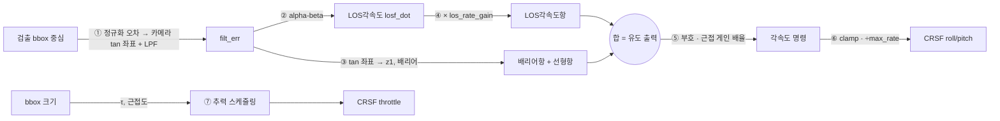

# IBVS 공선유도 제어 수식 정리 (guidance_mode 2)

`arms_control_node` 의 자동요격(TRACK)에서 **카메라 픽셀 오차 → 각속도 명령 + 추력** 이
어떻게 계산되는지 단계별로 정리한 문서다. 코드는
[`arms_control_node.cpp`](../arms_ws/src/arms_control/src/arms_control_node.cpp) 의 `control_loop()`,
파라미터는 [`control_params.yaml`](../arms_ws/src/arms_control/config/control_params.yaml)
(SITL 기준) + [`hw_overrides.yaml`](../arms_ws/src/arms_control/config/hw_overrides.yaml) (실기체 덮어쓰기).

각 단계 값은 비행 중 `/arms/control/ibvs_debug` (`arms_msgs/IbvsDebug`) 로 전부 발행되고, auto_save 로
녹화한 기록은 [`SW/scripts/ibvs_viewer`](../scripts/ibvs_viewer/README.md) 에서 그래프로 볼 수 있다.
아래 각 절의 **📈** 는 그 값이 뷰어의 어느 필드인지 표시한 것이고, 그래프별로 선이 무엇이고
각 필드의 수식은 [11. 뷰어 그래프별 필드 수식](#11-뷰어-그래프별-필드-수식) 에 정리했다.

> 논문: Yang, Bai, She, Quan, *High-Speed Interception Multicopter Control by Image-based
> Visual Servoing* (arXiv:2404.08296) 식 (12),(13) 을 우리 기체 기하에 맞게 단순화한 것.

---

## 0. 한 장 요약



한 줄로 쓰면 (roll 축 기준, pitch 도 같은 모양):

$$
\omega_{roll} = \text{clamp}\Big(s_{roll}\cdot g_{near}\cdot\big[\underbrace{(k_{g}\,B(z_1) + k_c)\,d_x}_{\text{겨누기}} + \underbrace{k_{los}\,\dot\lambda_x}_{\text{리드/감쇠}}\big],\ \pm\omega_{max}\Big)
$$

$$
\text{thrust} = h + (u - h)\cdot q_{center}\cdot e_\tau,\qquad u = h + (t - h)\cdot g_{near,thr}
$$

- **회전**: "표적 쪽으로 기울여라(겨누기) + 표적이 움직이는 쪽으로 미리 더 돌아라(리드)".
- **추력**: 기본은 최대(track), 가까워지면(크기) 그리고 곧 부딪히면(τ) hover 쪽으로 눌러 속도를 줄인다.

**왜 이게 되나 — 우리 기체의 기하.** 카메라가 기체 +Z(= 추력축)를 본다. 그래서
"표적을 화면 중앙에 놓는다 = 추력축이 표적을 향한다 = 밀면 표적으로 간다" 가 된다.
겨누기와 가기가 같은 동작이다. 또 이 기하 덕분에 오차가 자세·거리 없이 **픽셀과 화각만으로**
계산되고(자세 $R_b^e$ 가 양변에서 상쇄), 회전축에 yaw 성분이 구조적으로 0 이라 yaw 는 중앙 고정이다.

---

## 1. 픽셀 오차와 필터 (LOCK 부터 갱신)

$$
e_{raw} = \frac{\text{bbox 중심}}{\text{화면 크기}} - 0.5 \quad(\pm 0.5 = \text{화면 가장자리})
$$

$$
x_m,y_m = \operatorname{camera\_model}(e_{raw,x}, e_{raw,y})
$$

$$
e_{filt} \leftarrow \alpha_{e}\, (x_m,y_m) + (1-\alpha_{e})\, e_{filt}
$$

- **역할**: bbox raw 값은 해상도 독립 전달용으로만 유지하고, control 경계에서 먼저 카메라 tan 좌표로 변환한다. 이 $e_{filt}$ (= 코드의 `los_x`)가 IBVS 의 입력이다.
- $\alpha_e$ 가 크면 민첩하지만 떨림이 그대로, 작으면 매끈하지만 늦다.
- **LOCK 단계부터** 미리 갱신한다(명령은 아직 안 나감). 발사(TRACK 진입) 순간 필터가 0 에서
  다시 시작하는 콜드스타트를 없애기 위함.
- 검출이 잠깐 끊기면 상태머신이 마지막 값을 유지한다(`detection_held`).
- ⚠ `deadzone` 은 **IBVS 에 적용되지 않는다**(mode 0 PID 전용).

📈 `raw_err_x/y`, `filt_err_x/y`, `detection_held`

## 2. LOS각속도 추정 — alpha-beta 필터

"표적이 화면에서 얼마나 빨리 움직이나" 를 추정한다. 단순 미분은 노이즈가 커서
예측-보정 필터를 쓴다.

$$
\hat\lambda = \lambda + \dot\lambda\,dt \quad(\text{예측}),\qquad r = e_{filt} - \hat\lambda \quad(\text{잔차})
$$

$$
\lambda \leftarrow \hat\lambda + \alpha\, r,\qquad \dot\lambda \leftarrow \dot\lambda + \frac{\beta}{dt}\, r,\qquad \dot\lambda \in [-3, 3]
$$

그다음 근거리 폭주 방지로 한 번 더 자른다: $\dot\lambda_{use} = \text{clamp}(\dot\lambda, \pm c_{los})$ ($c_{los}$ = `pn_los_clamp`).

- 단위는 **[tan/s]** — 카메라의 수평·수직 화각과 종횡비를 반영한 시선 좌표 변화율이다.
- $\alpha$: 위치를 얼마나 측정 쪽으로 당길지, $\beta$: 속도를 얼마나 빨리 고칠지.
  $\beta$ 를 낮추면 리드가 매끈해지지만 늦게 반응한다.
- ⚠ **자기회전 오염**: 이 값은 카메라 좌표 변화라서 "표적이 움직여서" 와 "내가 회전해서
  카메라가 같이 돌아서" 가 섞여 있다(자이로 보정 미구현). 4절 LOS각속도항 진동의 원인.

📈 `losf_x/y`, `losf_x_dot/y_dot`, `los_rate_x/y`(clamp 후 = 실제 사용값)
(참고: `err_dot_x/y` 는 mode 0 용 단순 미분 추정. IBVS 는 안 씀)

## 3. 겨누기 항 — 공선 오차 $z_1$ 과 배리어

### 3-1. 픽셀 → 각도 (tan 좌표)

$$
x_n = \frac{u - c_x}{f_x},\quad y_n = \frac{v - c_y}{f_y}\quad(\text{+ 렌즈 왜곡 역보정})
$$

- 실기체(`camera.calibrated: true`)는 캘리 값 $f_x, f_y, c_x, c_y$, 왜곡계수로 계산.
- 캘리가 없으면 화각 근사: $x_n = 2\tan(\text{hfov}/2)\cdot e_x$, $y_n = 2\tan(\text{hfov}/2)\cdot\text{aspect}\cdot e_y$.
- $(x_n, y_n, 1)$ 이 카메라에서 표적을 향하는 방향 벡터다.

### 3-2. 공선 오차 $z_1$

$$
N = \sqrt{1 + x_n^2 + y_n^2},\qquad \cos\theta = \frac{1}{N},\qquad z_1 = 1 - \cos\theta
$$

- $\theta$ = 표적이 광축(= 추력축)에서 벗어난 각도. **$z_1 = 0$ 이면 정확히 겨눈 것**.
- 작은 각에서는 $z_1 \approx \theta^2/2$ — 오차의 "제곱" 처럼 자란다.

### 3-3. 배리어 함수

$$
B(z_1) = \frac{z_1}{k_b^2 - z_1^2},\qquad z_1 \le 0.995\,k_b \ \text{로 강제}
$$

- **역할: 표적을 화면 밖으로 놓치지 않게 하는 "벽"**. $z_1$ 이 $k_b$ 에 다가가면 분모가 0 이 되어
  게인이 발산한다 → 가장자리로 갈수록 필사적으로 돌린다.
- 중앙 근처에서는 거의 0 → 부드럽다.
- $z_1 \ge k_b$ 가 되면 분모가 음수가 되어 **명령 부호가 뒤집힌다(표적 반대로 회전)**. 그래서
  $0.995\,k_b$ 에서 자른다. 걸리면 `z1_clamped = 1`.
- $k_b = 0.55$ → 벽의 위치 $\theta = \arccos(1-0.55) \approx 63°$.
  현재 카메라(fx=231, 720×480)의 화면 가장자리: 좌우 끝 $z_1\approx0.46$ (57°),
  상하 끝 $z_1\approx0.31$ (46°), **모서리 $z_1\approx0.53$** (62°). 즉 벽은 모서리 바로 바깥.

### 3-4. 회전 방향

$$
d_x = \frac{x_n}{N},\qquad d_y = \frac{y_n}{N}\qquad(|d| = \sin\theta)
$$

회전축 = $e_3 \times$ (표적 방향). 크기가 $\sin\theta$ 라서 이것도 오차에 비례해 커진다.

### 3-5. 겨누기 항 = 배리어항 + 선형항

$$
\text{겨누기}_x = \underbrace{k_g\, B(z_1)\, d_x}_{\text{배리어항}} + \underbrace{k_c\, d_x}_{\text{선형항}}
$$

- **배리어항** ($k_g$ = `ibvs_gain`): 중앙 근처에서 $B\cdot d \propto \theta^3$ — 거의 0.
  가장자리에서 폭발적으로 커진다. "놓칠 것 같을 때" 담당.
- **선형항** ($k_c$ = `ibvs_center_gain`): $\propto \sin\theta \approx \theta$. 순수 배리어가 중앙에서
  힘이 없는 구간을 메운다(논문은 자세루프가 메우는데 우리는 그게 없어서 추가). "평소 겨누기" 담당.
  0 으로 두면 논문 그대로의 순수 배리어 거동.

**크기 감 잡기** (현재값 $k_g=200$, $k_c=100$, $k_b=0.55$, 합성 벡터 크기 [deg/s]):

| 이탈각 θ | $z_1$ | $B(z_1)$ | 배리어항 | 선형항 | 합 |
|---:|---:|---:|---:|---:|---:|
| 10° | 0.015 | 0.05 | 1.7 | 17.4 | **19** |
| 20° | 0.060 | 0.20 | 13.8 | 34.2 | **48** |
| 30° | 0.134 | 0.47 | 47.1 | 50.0 | **97** |
| 40° | 0.234 | 0.94 | 121.4 | 64.3 | **186** |
| 50° | 0.357 | 2.04 | 312.9 | 76.6 | **390 → 227.5 포화** |

→ 30° 이하는 선형항이 주도, 40° 부근부터 배리어가 주도, 50° 이상은 출력 상한에 붙는다.

📈 `x_n`, `y_n`, `theta_deg`, `z1_raw`, `z1`, `z1_clamped`, `kb`, `barrier`, `dir_x/y`,
`barrier_term_x/y`, `center_term_x/y`

## 4. 리드/감쇠 항 — LOS각속도항

$$
\text{리드}_x = k_{los}\,\dot\lambda_x
$$

- **역할 ① 리드(예측 조준)**: 표적이 화면을 가로지르면 그 방향으로 미리 더 돈다. 겨누기 항만으로는
  "표적이 지금 있는 곳" 만 쫓는 pure pursuit 라서, 횡단 표적은 가까워질수록 LOS각속도가
  1/거리로 치솟아(3.6 m/s 표적: 10 m 에서 21°/s, 3 m 에서 69°/s) **종말에 반드시 빗나간다**.
- **역할 ② 감쇠(브레이크)**: 내가 과하게 돌아서 오차가 빠르게 줄어들면 $\dot\lambda$ 가 반대 부호 →
  회전을 늦춘다. PID 의 D 항과 같은 역할.
- **크기의 의미**: 항법계수 $N = k_{los} / (k_x \cdot 57.3)$, $k_x = 2\tan(\text{hfov}/2) \approx 3.11$.
  - 175 → N≈1.0: 시선과 같은 속도로 돈다(리드 없음)
  - **220 → N≈1.2: 약한 리드 (현재)**
  - 350 → N≈2.0: 강한 리드, SITL 에서 심한 진동
- ⚠ **진동 주의**: 2절의 자기회전 오염 때문에 "내가 돈 것" 을 "표적이 빠르다" 로 착각해 더 돌고,
  그게 더 큰 착각을 만드는 되먹임이 생길 수 있다. 흔들리면 ↓, 종말에 뒤처지면 ↑.

📈 `los_rate_term_x/y`

### 유도 출력

$$
G_x = \text{겨누기}_x + \text{리드}_x
$$

📈 `guidance_x/y` (부호·스케줄링 전)

## 5. 회전 스케줄링 — 부호와 근접 게인 배율

$$
\omega_{cmd} = s_{roll}\cdot g_{near}\cdot G_x
$$

**부호** $s$ (`roll_sign`, `pitch_sign`, ±1): 카메라 장착 방향과 FC 축 방향을 맞추는 용도.

**근접 게인 배율** $g_{near}$ — 화면 속 표적 크기로 거리를 대신한다:

$$
c = \text{clamp}\!\left(\frac{s_{bbox} - s_{start}}{s_{full} - s_{start}},\ 0,\ 1\right),\qquad g_{near} = 1 - c\,(1 - g_{min})
$$

- $s_{bbox}$ = bbox 크기 EMA (`loom_size`, $\max(w,h)$ 정규화).
- **역할**: 가까울수록 같은 실제 오차도 화면에서 크게 보여 과민반응(오버슈트)하기 쉽다 → 게인을 낮춘다.
- 현재값: 크기 0.15 부터 줄기 시작 → 0.35 에서 ×0.4 까지.

| bbox 크기 | ≤0.15 | 0.20 | 0.25 | 0.30 | ≥0.35 |
|---|---:|---:|---:|---:|---:|
| $c$ | 0 | 0.25 | 0.5 | 0.75 | 1 |
| 회전 배율 $g_{near}$ | 1.0 | 0.85 | 0.70 | 0.55 | 0.40 |

> 이 배율은 guidance_mode 0/1/2 모두에 공통으로 걸린다.

📈 `closeness`, `range_gain_scale`, `roll_rate_cmd`, `pitch_rate_cmd`

## 6. 출력 — 포화와 CRSF 변환

$$
\omega_{out} = \text{clamp}(\omega_{cmd},\ \pm\,\omega_{max}),\qquad
\text{stick} = \frac{\omega_{out}}{\omega_{full}}
$$

($\omega_{max}$ = `max_cmd_rate_dps`, $\omega_{full}$ = `max_rate_dps`)

- 각속도 천장은 `max_cmd_rate_dps`(227.5°/s) **하나뿐**이다. 걸리면 `rate_saturated = 1`.
- PX4 는 **ACRO** 고정(각속도 모드, 자동수평 없음): 스틱 ±1 = ±`max_rate_dps`(400°/s,
  PX4 `MC_ACRO_R/P_MAX` 와 일치해야 함). 즉 227.5 는 스틱의 약 57% 까지만 쓴다는 뜻.
- yaw 는 항상 중앙(= yaw 각속도 0).

📈 `roll_rate_out`, `pitch_rate_out`, `rate_saturated` (뷰어 "⑥ 명령 vs 기체 자세" 에서
CRSF 텔레메트리 자세와 같이 보인다)

---

## 7. 추력 스케줄링 (TRACK에서만, 그 외 0)

세 단계가 곱으로 걸린다: **근접도(크기) → 정렬 품질 → τ(충돌 임박)**. 전부 hover 와 track 사이를
오가는 보간이고, **어떤 경우에도 hover 아래로는 안 내려간다**.

### 7-1. 근접도로 최대 추력 낮추기

$$
u = h + (t - h)\cdot g_{near,thr},\qquad g_{near,thr} = 1 - c\,(1 - g_{min,thr})
$$

- $h$ = `hover_throttle`, $t$ = `track_throttle`, $c$ 는 5절과 같은 근접도.
- **역할**: 회전 게인만 줄이면 스쳐 지나가는 시간은 그대로다 → 속도도 같이 줄여야 반응할 시간이 생긴다.
- 실기체(h=0.51, t=0.70, 최근접 ×0.6): 멀 때 $u$=0.70 → bbox 0.35 이상에서 $u$=0.624.

### 7-2. 정렬 품질 (`pursuit_center_boost`, 현재 **off**)

$$
q_{center} = \text{clamp}\!\left(1 - \frac{|e_{filt}|}{g_p},\ 0,\ 1\right)\quad(\text{off 면 } q_{center}=1)
$$

($g_p$ = `pursuit_gate`)

- on 이면: 잘 겨눴을 때만 세게 밀고, 빗나가면 hover 로 낮춰 재조준을 우선한다.
- 지금은 off → 정렬과 무관하게 $u$ 까지 민다.

### 7-3. τ(충돌까지 시간)로 감속

$$
\tau = \frac{s_{bbox}}{\dot s_{bbox}}\ \ (\text{커지는 중일 때만, 아니면 } +\infty),\qquad
e_\tau = \text{clamp}\!\left(\frac{\tau - \tau_{full}}{\tau_{start} - \tau_{full}},\ e_{min},\ 1\right)
$$

- $\tau$ = "몇 초 뒤 부딪히나". 크기와 **팽창 속도**를 같이 봐서, 크기만 보는 7-1 이 모르는
  "빠르게 다가오는 중" 을 안다. 표적 실제 크기·카메라와 무관(스케일 불변).
  - $s$ EMA: $s \leftarrow a_s s_{new} + (1-a_s)s$, 팽창률 EMA: $\dot s \leftarrow a_r \frac{\Delta s}{dt} + (1-a_r)\dot s$
  - 표적을 못 보거나 안 다가오면 $\tau=+\infty \Rightarrow e_\tau = 1$ (영향 없음).
- **역할**: 겨냥이 완벽해도 관성 때문에 표적을 살짝 지나치는 것을 막는다(SITL: "살짝 위로 가서 못 맞춤").
- 현재값($\tau_{start}$=2.5 s, $\tau_{full}$=0.3 s, $e_{min}$=0):

| τ [s] | ≥2.5 | 2.0 | 1.4 | 0.8 | ≤0.3 |
|---|---:|---:|---:|---:|---:|
| $e_\tau$ | 1.0 | 0.77 | 0.50 | 0.23 | 0 (= hover) |

> ⚠ 2.5 s 는 정지 표적 명중 기준 스냅샷이다. 움직이는 표적에는 접근 추력을 너무 일찍 죽인다
> (yaml 주석 참고). 못 따라붙으면 `tau_ease_start` ↓ 또는 `tau_ease_min_scale` ↑.

### 7-4. 최종 추력

$$
\text{thrust} = h + (u - h)\cdot q_{center}\cdot e_\tau
$$

**예시(실기체값)**: bbox 0.35(최근접), τ=1.4 s → $u$=0.624, $e_\tau$=0.5 →
thrust = 0.51 + 0.114×0.5 = **0.567**.

📈 `range_throttle_scale`, `throttle_up`(= $u$), `emag`, `center_q`, `loom_size`, `loom_rate`,
`tau`(∞ 는 9.99), `tau_ease`, `thrust`

---

## 9. 관련 파라미터

"현재값" = 런치가 실제로 읽는 값(`control_params.yaml`, 실기체는 `hw_overrides.yaml` 이 덮어씀).
모든 항목은 런타임 변경 가능(`ros2 param set /arms_control_node <이름> <값>`) — 단,
`control.camera.*` 는 기동 시 1회만 읽는다.

### 겨누기 / 리드 (IBVS 전용)

| 파라미터 | 현재값 | 수식 기호 | 역할 · 튜닝 |
|---|---|---|---|
| `control.guidance_mode` | 2 | — | 0=PID, 1=PN, **2=IBVS** |
| `control.ibvs_gain` | 200 | $k_g$ | 배리어항 세기. 가장자리 복원력. 표적을 자꾸 놓치면 ↑ |
| `control.ibvs_center_gain` | 100 | $k_c$ | 선형항. 평소 겨누기 세기. 느리게 붙으면 ↑, 중앙에서 흔들리면 ↓ |
| `control.ibvs_kb` | 0.55 | $k_b$ | 배리어 벽 위치($z_1$). ↓ = 더 중앙에 붙잡음(공격적). 화면 모서리 0.53 보다 커야 함 |
| `control.ibvs_los_rate_gain` | 220 | $k_{los}$ | 리드/감쇠. 흔들리면 ↓(175까지), 종말에 뒤처지면 ↑(350 은 진동) |
| `control.ibvs_hfov_deg` / `ibvs_aspect` | 114.59 / 0.667 | — | 캘리 없을 때만 쓰는 화각 근사(SITL) |
| `control.camera.*` | calibrated (실기체) | $f, c$, 왜곡 | 픽셀 → tan 좌표 변환. 실기체 체커보드 캘리 |

### 필터 / 추정

| 파라미터 | 현재값 | 수식 기호 | 역할 · 튜닝 |
|---|---|---|---|
| `control.error_lpf_alpha` | 0.25 | $\alpha_e$ | 오차 LPF. ↑ 민첩/떨림, ↓ 매끈/지연 |
| `control.pn_alpha` | 0.35 | $\alpha$ | alpha-beta 위치 이득 |
| `control.pn_beta` | 0.02 | $\beta$ | alpha-beta 속도 이득. ↓ 리드 매끈/늦음 (IBVS 진동 시 의심) |
| `control.pn_los_clamp` | 1.5 | — | LOS각속도 상한 [화면/s]. PN(mode 1)과 공유 |
| `mission.loom_size_alpha` | 0.3 | $a_s$ | bbox 크기 EMA (근접도·τ 공통) |
| `mission.loom_rate_alpha` | 0.3 | $a_r$ | 팽창률 EMA (τ 안정화) |

### 회전 스케줄링 / 출력

| 파라미터 | 현재값 | 수식 기호 | 역할 · 튜닝 |
|---|---|---|---|
| `control.roll_sign` / `pitch_sign` | 1 / 1 | $s$ | 축 방향 맞춤(±1). 반대로 돌면 뒤집기 |
| `control.near_size_start` | 0.15 | $s_{start}$ | 근접 스케줄 시작 bbox 크기 |
| `control.near_size_full` | 0.35 | $s_{full}$ | 근접 스케줄 최대 적용 크기 |
| `control.min_gain_scale` | 0.4 | $g_{min}$ | 최근접 회전 배율(1.0 = 끔) |
| `control.max_cmd_rate_dps` | 227.5 | $\omega_{max}$ | 각속도 명령 상한 [deg/s] |
| `control.max_rate_dps` | 400 | — | 풀스틱 각속도. PX4 `MC_ACRO_R/P_MAX` 와 반드시 일치 |
| `control.control_rate_hz` | 50 | — | 제어 주기 |

### 추력

| 파라미터 | 현재값 | 수식 기호 | 역할 · 튜닝 |
|---|---|---|---|
| `control.hover_throttle` | 0.32 (**실기체 0.51**) | $h$ | 추력 하한(호버). PX4 `MPC_THR_HOVER` 와 일치 |
| `control.track_throttle` | 0.66 (**실기체 0.70**) | $t$ | 추력 상한(돌진). 못 쫓으면 ↑ |
| `control.min_throttle_scale` | 0.6 | $g_{min,thr}$ | 최근접 추력 상한 배율(1.0 = 끔) |
| `control.pursuit_center_boost` | false | — | true 면 정렬 품질 $q_{center}$ 적용 |
| `control.pursuit_gate` | 0.25 | — | $q_{center}$=0 이 되는 오차 크기(boost on 일 때만) |
| `control.tau_ease_start` | 2.5 | $\tau_{start}$ | τ 감속 시작 [s]. 움직이는 표적에 늦으면 ↓ |
| `control.tau_ease_full` | 0.3 | $\tau_{full}$ | 최대 감속 지점 [s] |
| `control.tau_ease_min_scale` | 0.0 | $e_{min}$ | τ 임박 시 배율 하한(0 = hover 까지, 1 = 끔) |

### IBVS 에 영향 없는 것 (헷갈림 방지)

`deadzone`, `gain_shaping`, `roll_pid.*` / `pitch_pid.*`, `lead_gain`, `err_dot_alpha` / `err_dot_clamp`
→ mode 0 (PID) 전용. `pn_nav_gain`, `pn_center_gain` → mode 1 (PN) 전용.

---

## 10. 증상별 튜닝 빠른 참고

| 증상 | 먼저 볼 그래프(뷰어) | 손댈 파라미터 |
|---|---|---|
| 표적이 화면 가장자리로 빠져 놓침 | ③ z1 / 배리어, `z1_clamped` | `ibvs_gain` ↑, `ibvs_kb` ↓ |
| 겨누기가 느림(중앙에 늦게 붙음) | ④ 항별 기여의 `center_term` | `ibvs_center_gain` ↑ |
| 카메라가 좌우로 흔들림(진동) | ② LOS각속도, ④ `los_rate_term` | `ibvs_los_rate_gain` ↓, `pn_beta` ↓ |
| 횡단 표적을 종말에 뒤쪽으로 빗나감 | ④ `los_rate_term` 이 작은지 | `ibvs_los_rate_gain` ↑ |
| 명령이 계속 상한에 붙음 | ⑥ `rate_saturated` | 게인 ↓ 또는 `max_cmd_rate_dps` ↑ |
| 표적을 살짝 지나침 | ⑤ τ, ⑦ `tau_ease` | `tau_ease_start` ↑, `tau_ease_min_scale` ↓ |
| 움직이는 표적을 못 따라붙음 | ⑦ `thrust` 가 일찍 hover 로 | `tau_ease_start` ↓, `track_throttle` ↑ |
| 가까이서 과민반응(오버슈트) | ⑤ `range_gain_scale` | `min_gain_scale` ↓, `near_size_start` ↓ |

---

## 11. 뷰어 그래프별 필드 수식

`ibvs_viewer` 패널 순서 그대로다. 범례 이름 = 필드명. ⚙ = 기록에 없는 중간값을 뷰어가
기록된 필드로 계산한 것(구 기록에도 나옴). 기호: `B = barrier`, `N = √(1+x_n²+y_n²)`,
`ldx/ldy = los_rate_x/y`.

roll 명령이 어떻게 쪼개지는지 (pitch 는 x→y):

```
roll_rate_out   = clamp(roll_sign · range_gain_scale · guidance_x, ±max_cmd_rate_dps)
guidance_x      = aim_term_x + los_rate_term_x
aim_term_x      = aim_gain · dir_x                    = barrier_term_x + center_term_x
aim_gain        = gain_barrier + ibvs_center_gain
gain_barrier    = ibvs_gain · barrier
barrier         = z1 / (kb² − z1²)
dir_x           = x_n / N
los_rate_term_x = ibvs_los_rate_gain · los_rate_x     (los_rate_x = ldx)
```

| 보고 싶은 것 | 필드 | 패널 |
|---|---|---|
| `z1/(kb²−z1²)` | `barrier` | IBVS raw terms (before gain) |
| `200·z1/(kb²−z1²)` | `gain_barrier` ⚙ | Gained coefficients |
| `200·z1/(kb²−z1²) + 100` | `aim_gain` ⚙ | Gained coefficients |
| `x_n/N` | `dir_x` | IBVS raw terms (before gain) |
| `[200·z1/(kb²−z1²) + 100] · x_n/N` | `aim_term_x` ⚙ | Roll term contributions |
| `ldx` | `los_rate_x` | IBVS raw terms (before gain) |
| `220·ldx` | `los_rate_term_x` | Roll term contributions |
| 두 항의 비중 | `aim_share_x`, `lead_share_x` ⚙ | Term share |

### Error

`raw_err_*`는 정규화 화면 오차, `filt_err_*`는 카메라 tan 좌표다.

| 필드 | 수식 |
|---|---|
| `raw_err_x` | bbox_cx/W − 0.5 (±0.5 = 화면 끝) |
| `filt_err_x` | α·camera_tan_x + (1−α)·filt_err_x (α = error_lpf_alpha) |
| `raw_err_y` | bbox_cy/H − 0.5 |
| `filt_err_y` | α·camera_tan_y + (1−α)·filt_err_y |

### Error angle

_[deg] · 카메라 광축 기준_

| 필드 | 수식 |
|---|---|
| `err_angle_x` ⚙ | atan(x_n) · 180/π [deg] (좌우 오차각, + = 오른쪽) |
| `err_angle_y` ⚙ | atan(y_n) · 180/π [deg] (상하 오차각, + = 아래) |
| `theta_deg` | acos(1/N) [deg] (전체 이탈각) |

### LOS rate

_[tan/s]_

| 필드 | 수식 |
|---|---|
| `losf_x_dot` | alpha-beta 속도 추정 [tan/s], clamp ±3 |
| `los_rate_x` | ldx = clamp(losf_x_dot, ±pn_los_clamp) |
| `losf_y_dot` | alpha-beta 속도 추정 [화면/s], clamp ±3 |
| `los_rate_y` | ldy = clamp(losf_y_dot, ±pn_los_clamp) |
| `err_dot_x` | LPF(Δfilt_err_x/dt), clamp ±err_dot_clamp (mode 0 전용) |
| `err_dot_y` | LPF(Δfilt_err_y/dt), clamp ±err_dot_clamp (mode 0 전용) |

### z1 / θ

_왼축 z1 · 오른축 θ[deg]_

| 필드 | 수식 |
|---|---|
| `z1_raw` | 1 − 1/N (= 1 − cos θ) |
| `z1` | min(z1_raw, 0.995·kb) |
| `kb` | ibvs_kb |
| `theta_deg` (오른축) | acos(1/N) [deg] (전체 이탈각) |

### IBVS raw terms (before gain)

_왼축 x_n/N · ldx · 오른축 B_

| 필드 | 수식 |
|---|---|
| `dir_x` | x_n / N |
| `dir_y` | y_n / N |
| `los_rate_x` | ldx = clamp(losf_x_dot, ±pn_los_clamp) |
| `los_rate_y` | ldy = clamp(losf_y_dot, ±pn_los_clamp) |
| `barrier` (오른축) | B = z1 / (kb² − z1²) |

### Gained coefficients

_[deg/s] · x_n/N 에 곱해지는 값_

| 필드 | 수식 |
|---|---|
| `gain_barrier` ⚙ | ibvs_gain · B [deg/s] |
| `aim_gain` ⚙ | ibvs_gain · B + ibvs_center_gain [deg/s] (= 대괄호 [ ]) |
| `ibvs_center_gain` | control.ibvs_center_gain |

### Roll term contributions

_[deg/s] · guidance_x = aim_term_x + los_rate_term_x_

| 필드 | 수식 |
|---|---|
| `aim_term_x` ⚙ | aim_gain · x_n/N = barrier_term_x + center_term_x [deg/s] |
| `los_rate_term_x` | ibvs_los_rate_gain · ldx [deg/s] |
| `barrier_term_x` | ibvs_gain · B · x_n/N [deg/s] |
| `center_term_x` | ibvs_center_gain · x_n/N [deg/s] |
| `guidance_x` | aim_term_x + los_rate_term_x [deg/s] |
| `roll_rate_out` | clamp(roll_rate_cmd, ±max_cmd_rate_dps) [deg/s] = 송신값 |

### Pitch term contributions

_[deg/s] · guidance_y = aim_term_y + los_rate_term_y_

| 필드 | 수식 |
|---|---|
| `aim_term_y` ⚙ | aim_gain · y_n/N = barrier_term_y + center_term_y [deg/s] |
| `los_rate_term_y` | ibvs_los_rate_gain · ldy [deg/s] |
| `barrier_term_y` | ibvs_gain · B · y_n/N [deg/s] |
| `center_term_y` | ibvs_center_gain · y_n/N [deg/s] |
| `guidance_y` | aim_term_y + los_rate_term_y [deg/s] |
| `pitch_rate_out` | clamp(pitch_rate_cmd, ±max_cmd_rate_dps) [deg/s] = 송신값 |

### Term share

_[%] · aim + lead = 100 (TRACK 에서만)_

| 필드 | 수식 |
|---|---|
| `aim_share_x` ⚙ | \|aim_term_x\| / (\|aim_term_x\| + \|los_rate_term_x\|) · 100 [%] |
| `lead_share_x` ⚙ | \|los_rate_term_x\| / (\|aim_term_x\| + \|los_rate_term_x\|) · 100 [%] |
| `aim_share_y` ⚙ | \|aim_term_y\| / (\|aim_term_y\| + \|los_rate_term_y\|) · 100 [%] |
| `lead_share_y` ⚙ | \|los_rate_term_y\| / (\|aim_term_y\| + \|los_rate_term_y\|) · 100 [%] |

### Command vs attitude

_왼축 [deg/s] · 오른축 CRSF 자세[deg]_

| 필드 | 수식 |
|---|---|
| `roll_rate_cmd` | roll_sign · range_gain_scale · guidance_x [deg/s] |
| `roll_rate_out` | clamp(roll_rate_cmd, ±max_cmd_rate_dps) [deg/s] = 송신값 |
| `pitch_rate_cmd` | pitch_sign · range_gain_scale · guidance_y [deg/s] |
| `pitch_rate_out` | clamp(pitch_rate_cmd, ±max_cmd_rate_dps) [deg/s] = 송신값 |
| `vehicle/attitude.roll_deg` (오른축) | CRSF 텔레메트리 roll [deg] |
| `vehicle/attitude.pitch_deg` (오른축) | CRSF 텔레메트리 pitch [deg] |

### Scheduling scales

_0~1_

| 필드 | 수식 |
|---|---|
| `closeness` | clamp((loom_size − near_size_start)/(near_size_full − near_size_start), 0, 1) |
| `range_gain_scale` | 1 − closeness·(1 − min_gain_scale) |
| `range_throttle_scale` | 1 − closeness·(1 − min_throttle_scale) |
| `tau_ease` | clamp((tau − tau_ease_full)/(tau_ease_start − tau_ease_full), tau_ease_min_scale, 1) |
| `center_q` | clamp(1 − emag/pursuit_gate, 0, 1) (pursuit_center_boost=false → 1) |

### Looming / τ

_왼축 loom_size·loom_rate · 오른축 tau[s]_

| 필드 | 수식 |
|---|---|
| `loom_size` | EMA(max(bbox_w, bbox_h), loom_size_alpha) |
| `loom_rate` | EMA(Δloom_size/dt, loom_rate_alpha) |
| `tau` (오른축) | loom_size / loom_rate [s] (loom_rate ≤ 0 → 9.99) |

### Thrust

_0~1_

| 필드 | 수식 |
|---|---|
| `thrust` | hover + (throttle_up − hover)·center_q·tau_ease |
| `throttle_up` | hover + (track − hover)·range_throttle_scale |
| `emag` | √(filt_err_x² + filt_err_y²) |

### Flags

_0/1_

| 필드 | 수식 |
|---|---|
| `cmd_active` | state = TRACK |
| `filter_active` | state ∈ {LOCK, TRACK} |
| `detection_held` | 검출 끊김 → 마지막 오차 유지 |
| `z1_clamped` | z1_raw > 0.995·kb |
| `rate_saturated` | \|rate_cmd\| > max_cmd_rate_dps |
| `manual_out` | 수동 모드 or RTL (스틱 passthrough) |

### Gains / dt

_왼축 게인 · 오른축 dt[ms]_

| 필드 | 수식 |
|---|---|
| `ibvs_gain` | control.ibvs_gain |
| `ibvs_center_gain` | control.ibvs_center_gain |
| `ibvs_los_rate_gain` | control.ibvs_los_rate_gain |
| `dt` (오른축) | 제어 틱 간격 [ms] |
