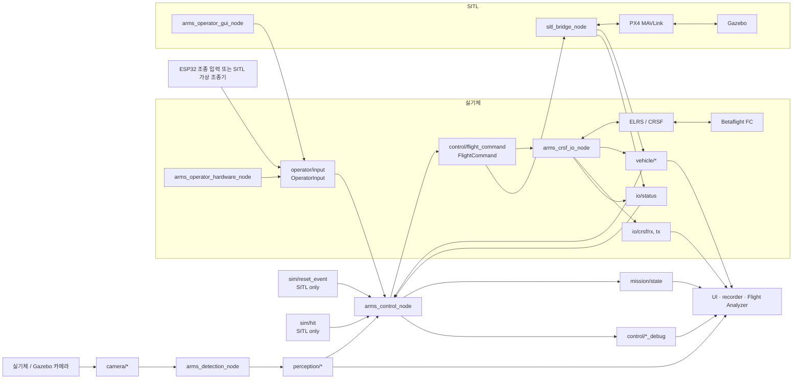

# I/O 분리 및 ROS 인터페이스 정리 계획

> 상태: **계획 단계**. 이 문서는 현재 인터페이스를 변경하지 않으며, 구현 착수 전에
> 토픽 계약과 노드 책임을 확정하기 위한 기준이다.

## 1. 목표

현재 `arms_control_node`는 제어 판단, ESP32 조종 입력 수신, CRSF 프레임 처리,
ELRS 송신, 실기체 telemetry 정규화를 함께 맡고 있다. 이 구조는 SITL과 실기체의
차이를 control 내부에 누적시키고, 비행 로그의 의미도 모호하게 만든다.

리팩터링 후의 원칙은 다음과 같다.

1. `arms_control_node`는 환경을 알지 않는다. 조종 의도·인식·정규화된 기체 상태를
   입력으로 받고, 정규화된 비행 명령과 미션 상태를 출력한다.
2. 실기체의 ESP32/ELRS/CRSF와 SITL의 MAVLink/PX4 차이는 I/O 어댑터에서 끝낸다.
3. UI, recorder, Flight Analyzer는 실기체와 SITL에 공통인 정규화 토픽만 사용한다.
4. 한 토픽에는 한 launch 구성에서 하나의 책임 있는 publisher만 둔다.
5. `io/status`는 link의 관측 결과이고, RTL 판단은 control의 책임이다.

### Namespace 규칙

이 문서의 **to-be 토픽 이름은 모두 상대 이름**이다. 노드 코드에는 선행 `/`나 고정
`arms` 토큰을 넣지 않는다. 최상위 launch가 `namespace` argument(기본값 `arms`)를
`PushRosNamespace`로 적용하며, 기본 실행에서만 `vehicle/gps`가
`/arms/vehicle/gps`로 해석된다.

```text
기본 launch:       namespace:=arms        → /arms/vehicle/gps
다기체 launch:     namespace:=arms/uav_01 → /arms/uav_01/vehicle/gps
노드 소스/계약:     vehicle/gps             (상대 이름)
```

As-is 열은 현재 실제 절대 이름을 보존해 표시한다.

### 호환성 방침

이 전환은 하위 호환을 제공하지 않는 **단일 API 전환**이다.

- old/new 토픽 alias, dual publisher, remap fallback을 넣지 않는다.
- 새 `ARMS Flight Analyzer`는 이전 토픽 이름이 든 rosbag을 열지 않는다.
- 새 recorder manifest에는 `topic_schema_version`을 기록하고, 이 전환 뒤에는 새
  schema만 지원한다.
- 기존 rosbag은 전환 전 버전의 viewer로만 열람한다.

그 대가로 control, UI, recorder, viewer가 하나의 이름·메시지 계약만 유지하게 된다.

### 시간축과 SITL reset 방침

- Flight Analyzer의 재생·영상·3D·그래프 동기화 기준은 **rosbag 저장 timestamp**다.
  recorder가 같은 호스트에서 관측한 단일 시간축이므로 현재 목적에 가장 적합하다.
- ROS header stamp는 측정·수신·생성 시각 및 지연 분석을 위한 보조 정보다. 모든 새
  정규화 메시지는 header stamp를 채우되, viewer의 주 시간축을 header stamp로 바꾸지 않는다.
- 현재 SITL은 `/clock`과 `use_sim_time`을 쓰지 않으며, 이 방침도 유지한다. manifest에는
  `use_sim_time`, launch namespace, `topic_schema_version`을 기록한다.
- `sim/reset` service와 `sim/reset_event` topic은 모두 유지한다. service는 panel의 요청/결과,
  event는 PX4 재기동 성공 뒤 control·referee·UI의 단순 상태 초기화 용도다. event는
  `std_msgs/Empty`, 기본 reliable/volatile QoS로 충분하며 lifecycle·reset ID는 도입하지 않는다.
- GPS Rescue 불가 상황의 fallback은 FC 설정에 맡긴다. `io/status`에는 RTL capability를 추가하지 않는다.

## 2. 목표 아키텍처



`io/status`의 publisher는 실행 환경별로 하나다.

- 실기체 launch: `arms_crsf_io_node`가 CRSF/FC telemetry 연결 상태를 발행한다.
- SITL launch: `sitl_bridge_node`가 PX4 MAVLink heartbeat/telemetry 상태를 발행한다.

`arms_control_node`는 status의 timeout이나 fault를 보고 RTL을 결정한다. I/O 노드는
상태를 관측·보고할 뿐 RTL 정책을 직접 결정하지 않는다.

### 2.1 패키지 경계

비행제어 통신 패키지명은 **`arms_flight_io`**를 권장한다. `telemetry`는 수신만 한다는
인상을 주지만 이 패키지는 RC 채널 송신도 담당하고, 단순 `arms_io`는 향후 카메라·디스크·
네트워크 I/O까지 포괄하는 지나치게 넓은 이름이기 때문이다.

```text
arms_operator       # ESP32/가상 조종기 → OperatorInput
arms_flight_io      # FC와의 통신 경계
  ├── arms_crsf_io_node    # 실기체: ELRS/CRSF 송수신 및 telemetry 정규화
  └── sitl_bridge_node     # SITL: MAVLink RC/telemetry 변환

arms_control         # 유도·상태 머신·failsafe 정책 → FlightCommand
arms_sim             # Gazebo referee, panel, sim_reset_manager
```

`arms_operator`로의 패키지 rename은 이 리팩터링과 동시에 하거나, 위험을 줄이기 위해
토픽 전환이 완료된 뒤 별도 커밋으로 해도 된다. 반면 `arms_crsf_io_node`와
`sitl_bridge_node`는 이번 전환에서 `arms_flight_io`로 옮긴다.

## 3. 토픽 계약: as-is → to-be

### 3.1 Operator, control, mission

| As-is | To-be | 주 publisher | 의미 |
| --- | --- | --- | --- |
| 구형 `/arms/command` (폐기) | `operator/input` | `arms_operator_hardware_node` | 조종자가 의도한 stick, arm, auto/manual, RTL 등 고수준 입력 |
| 없음 | `control/flight_command` | `arms_control_node` | 정규화된 최종 비행 명령. CRSF I/O와 SITL bridge가 기체별 RC/AUX·MAVLink로 변환 |
| `/arms/control_debug` | `control/debug` | `arms_control_node` | 제어 상태와 일반 디버그 값 |
| `/arms/ibvs_debug` | `control/ibvs_debug` | `arms_control_node` | image error, LOS rate, bbox, thrust 등 IBVS 값 |
| `/arms/debug_looming` | `control/looming_debug` | `arms_control_node` | looming 유도 디버그 값 |
| `/arms/mission_state` | `mission/state` | `arms_control_node` | IDLE, SEARCH, LOCK, TRACK, RTL 등 |

`operator/input`의 메시지는 기존 `sensor_msgs/Joy` 대신 목적이 드러나는
`arms_msgs/OperatorInput`으로 교체한다. `control/flight_command`는 `Joy`나 실제 RC
채널 배열이 아닌 `arms_msgs/FlightCommand`를 사용한다. 양자는 이름과 메시지 타입 모두
달라야 한다.

### 3.2 I/O 및 기체 telemetry

| As-is | To-be | 주 publisher | 의미 |
| --- | --- | --- | --- |
| 없음 | `io/status` | 실기체: `arms_crsf_io_node`<br>SITL: `sitl_bridge_node` | CRSF/FC 또는 PX4 telemetry 링크 상태, 마지막 수신 시각, fault 원인 |
| `/arms/crsf_rx` | `io/crsf/rx` | `arms_crsf_io_node` | 실기체 수신 CRSF 원시 프레임 및 기록용 진단 정보 |
| `/arms/crsf_tx` | `io/crsf/tx` | `arms_crsf_io_node` | 실기체 송신 CRSF 원시 프레임 및 기록용 진단 정보 |
| `/arms/gps` | `vehicle/gps` | 실기체: `arms_crsf_io_node`<br>SITL: `sitl_bridge_node` | 위치·속도·고도·GPS fix·위성 수 |
| `/arms/attitude` | `vehicle/attitude` | 실기체: `arms_crsf_io_node`<br>SITL: `sitl_bridge_node` | roll, pitch, yaw |
| `/arms/battery` | `vehicle/battery` | `arms_crsf_io_node` | 전압, 전류, 잔량 등 배터리 telemetry |

`vehicle/*`는 환경에 독립적인 공개 계약이다. 실기체에서는 CRSF telemetry에서,
SITL에서는 PX4 MAVLink에서 같은 의미의 메시지로 변환해 발행한다.

### 3.3 Camera, perception, UI

| As-is | To-be | 의미 |
| --- | --- | --- |
| `/arms/image_raw` | `camera/image_raw` | 원본 카메라 영상 |
| `/arms/camera_info` | `camera/camera_info` | 카메라 intrinsics 등 `CameraInfo` |
| `/arms/image_raw/compressed` | `camera/image_raw/compressed` | 압축 원본 영상 |
| `/arms/image_raw/compressedDepth` | `camera/image_raw/compressedDepth` | image_transport 파생 토픽 |
| `/arms/image_raw/theora` | `camera/image_raw/theora` | image_transport 파생 토픽 |
| `/arms/detections` | `perception/detections` | control이 사용할 확정 검출 결과 |
| `/arms/detections_raw` | `perception/detections_raw` | 필터 전 또는 분석용 검출 결과 |
| `/arms/detector_status` | `perception/status` | detector 준비·성능·오류 상태 |
| `/arms/debug_image` | `perception/debug_image` | 검출 오버레이 영상 |
| `/arms/hsv_debug_image` | `perception/hsv_debug_image` | HSV segmentation 디버그 영상 |
| `/arms/ui_image` | `ui/image` | 오퍼레이터 UI 오버레이 영상 |
| `/arms/ui_image/compressed` | `ui/image/compressed` | 압축 UI 영상 |

### 3.4 SITL 전용 인터페이스

| As-is | To-be | 주체 | 의미 |
| --- | --- | --- | --- |
| `/arms/hit` | `sim/hit` | `arms_sim/referee` | SITL 명중 판정 이벤트 |
| `/arms/sitl/reset` 서비스 | `sim/reset` 서비스 | `sim_reset_manager` | PX4만 재시작하고 Gazebo는 유지하라는 요청 |
| `/arms/reset` 토픽 | `sim/reset_event` | `sim_reset_manager` | PX4 재기동 성공 뒤 control, referee, UI 등에 알리는 초기화 이벤트 |
| `/arms/viz/drone_path` | `sim/viz/drone_path` | SITL bridge | Gazebo truth 기반 기체 궤적 |
| `/arms/viz/target_path` | `sim/viz/target_path` | SITL bridge | Gazebo truth 기반 표적 궤적 |
| `/arms/viz/markers` | `sim/viz/markers` | SITL bridge | Gazebo truth 기반 RViz marker |

실기체에는 `sim/reset`과 `sim/reset_event`를 launch하지 않는다. Reset panel은
`arms_sim` 소속의 서비스 **client**이고, reset을 수행하거나 이벤트를 발행하지 않는다.

```text
arms_sim reset panel
  → sim/reset service
      → sim_reset_manager: PX4 재기동과 완료 확인
          → sim/reset_event topic
```

## 4. 노드 책임 변경

### `arms_operator_hardware_node`

- 실기체: ESP32 serial 패킷을 읽고 `OperatorInput`으로 변환한다.
- SITL: 가상 조종기 UI를 동일한 `OperatorInput`으로 변환한다.
- 링크 끊김 자체를 RTL로 바꾸지 않는다. control이 `OperatorInput`의 마지막 수신 시각을
  기준으로 timeout과 RTL을 판단한다.

### `arms_control_node`

- CRSF serial, ELRS, MAVLink, Gazebo를 직접 알지 않는다.
- `operator/input`, `perception/*`, `vehicle/*`, `io/status`를
  구독한다.
- operator input timeout, I/O fault, operator RTL 요청, target loss에 따라 미션 상태와
  RTL을 판단한다.
- `control/flight_command`만으로 FC 조작 의도를 내보낸다.

### `arms_crsf_io_node` — 실기체 전용

- CRSF/ELRS UART의 유일한 owner다.
- `control/flight_command`를 구독하여 Betaflight의 RC/AUX 매핑에 맞는 CRSF RC frame을 송신한다.
- 수신 CRSF telemetry를 `vehicle/gps`, `vehicle/attitude`,
  `vehicle/battery`로 정규화한다.
- 원시 통신 관찰용 `io/crsf/rx`, `io/crsf/tx`를 발행한다.
- CRSF/FC telemetry freshness를 `io/status`로 발행한다. 이 노드는 통신 상태를
  관측할 뿐 RTL 정책을 갖지 않는다.

### `sitl_bridge_node` — SITL 전용

- `control/flight_command`를 PX4의 MAVLink RC 입력·arm·mode·RTL 명령으로 변환한다.
- PX4 MAVLink telemetry를 `vehicle/gps`, `vehicle/attitude`로 정규화한다.
- PX4 heartbeat/telemetry freshness를 `io/status`로 발행한다.
- PX4 재시작은 직접 판단하지 않고 `sim_reset_manager`의 명령을 수행한다.

## 5. 메시지 초안

정확한 필드와 단위는 구현 전 별도 message review에서 확정한다. 아래는 책임을 드러내는
최소 형태다.

```text
OperatorInput
  header, roll, pitch, throttle, yaw
  arm_switch, auto_switch, rtl_switch, launch_request, input_lost

FlightCommand
  header, roll, pitch, throttle, yaw
  arm, manual_mode, rtl_request
  # -1..1 또는 throttle 0..1의 기체 비종속 명령. RC 채널값은 담지 않는다.

IoStatus
  header
  source                        # CRSF 또는 PX4
  transport_connected
  vehicle_telemetry_connected
  last_rx_age_ms, last_vehicle_telemetry_age_ms
  fault_reason
```

SITL에서 의미 없는 field는 0이나 false로 꾸며내기보다 `valid`/source 표시를 두어
명시적으로 unavailable로 표현한다.

## 6. 전환 순서

1. 새 메시지(`OperatorInput`, `FlightCommand`, `IoStatus`)와 새 토픽을 추가한다.
2. `arms_operator_hardware_node`와 `arms_operator_gui_node`로 기존 ESP32·가상 조종기 출력을
   `operator/input`으로 옮긴다.
3. control의 serial/CRSF 의존을 제거하고 `control/flight_command`를 발행하도록
   전환한다. 이 단계에서 input timeout과 RTL 정책도 control로 이동한다.
4. 실기체 `arms_crsf_io_node`를 별도 패키지에 추가하고, 여기에서 `io/status`도
   발행한다.
5. `sitl_bridge_node`를 동일한 `flight_command`·`vehicle`·`io/status` 계약에 맞춘다.
6. camera, perception, mission, debug 토픽을 namespace별로 일괄 전환하고 launch remap을
   제거한다.
7. `DESIGN.md`의 패키지 구조, 노드 그래프, 토픽 표, 상태·reset 설명을 새 package와
   상대 토픽 namespace 규칙으로 전면 갱신한다.
8. UI와 recorder의 구독 목록을 새 토픽으로 갱신한다. recorder manifest에는
   `topic_schema_version`과 launch namespace를 저장한다.
9. `scripts/ibvs_viewer`의 bag reader, telemetry/graph binding, 화면 라벨을 새 상대
   토픽 계약으로 갱신한다. 구형 bag fallback은 구현하지 않으며, schema version이 맞지
   않으면 지원하지 않는 로그임을 명확히 알린다.
10. 실기체와 SITL 각각에서 topic graph, timeout RTL, arm disarm, GPS/attitude/battery
   recording을 검증한 뒤 legacy 토픽과 CRSF 직접 접근 코드를 제거한다.

전환 중에는 old/new 토픽을 장기간 병행 발행하지 않는다. 병행 publisher는 RC 채널과
상태 이벤트에서 race를 만들기 쉽다. 각 단계는 launch 단위로 원자적으로 전환한다.

## 7. 완료 기준

- control source에 CRSF, UART device, MAVLink, Gazebo 조건 분기가 없다.
- 실기체와 SITL 모두 control이 같은 `FlightCommand` 메시지를 출력한다.
- UI, recorder, Flight Analyzer가 `vehicle/*`, `io/status`, `mission/state`,
  `control/*`만으로 동일한 화면과 로그를 만든다.
- ESP32 입력 단절은 control이 `OperatorInput` timeout으로, FC/PX4 telemetry 단절은
  `io/status`로 감지하여 정의된 시간 기준으로 RTL을 요청한다.
- SITL reset은 Gazebo를 유지한 채 PX4를 재기동하고, 성공했을 때만
  `sim/reset_event`를 한 번 발행한다.
- `DESIGN.md`, recorder manifest, ARMS Flight Analyzer가 모두 같은
  `topic_schema_version`과 상대 토픽 목록을 참조한다.
- 구형 토픽만 들어 있는 rosbag은 새 Flight Analyzer에서 지원 대상이 아니다.
